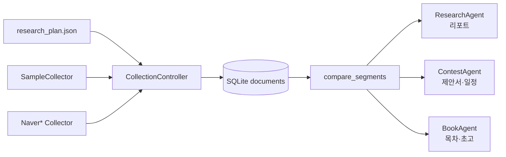

# 소셜 리서치 에이전트 (sma)

조현호 아이디어 **"국내 거주 외국인과 내국인의 생활권 및 교류 공간 분석"** 을
실행 가능한 파이프라인으로 구체화한 프로젝트입니다.

개인과제 → 공모전 출품 → 단행본 집필까지 **같은 분석 결과를 재사용**하도록 설계했습니다.

## 구조

```
수집기(Collector)            수집 컨트롤러             분석                에이전트
 ├ SampleCollector      →   CollectionController  →  compare_segments  →  ResearchAgent  (개인과제)
 ├ NaverBlogCollector       · 호출 간격 제어          · 키워드/변별어        ContestAgent   (공모전)
 ├ NaverCafeCollector       · 재시도 + 백오프         · 감성 분포            BookAgent      (집필)
 └ NaverLocalCollector      · 중복 제거 / SQLite      · 생활권 겹침
```



## 빠른 실행

외부 패키지 없이 Python 3.10+ 표준 라이브러리만으로 동작합니다.

```bash
cd project

python3 -m unittest discover -s tests        # 테스트
PYTHONPATH=src python3 -m sma status         # 수집기 상태·적재 현황
PYTHONPATH=src python3 -m sma all            # 과제 → 공모전 → 책 전체 실행
```

개별 실행:

```bash
PYTHONPATH=src python3 -m sma collect --source sample
PYTHONPATH=src python3 -m sma research                  # 수집 + 분석 + 리포트
PYTHONPATH=src python3 -m sma analyze                   # 기존 DB로 분석만 재실행
PYTHONPATH=src python3 -m sma contest --name "2026 공모전" --deadline 2026-06-30
PYTHONPATH=src python3 -m sma book --title "섞이지 않는 도시" --months 6
PYTHONPATH=src python3 -m sma reset                     # 수집 DB 초기화
```

> 전역 옵션(`--plan`, `--db`, `--output`, `--source`, `--quiet`)은 하위 명령 **앞**에 둡니다.

## 실제 데이터 수집 붙이기

샘플 수집기만으로도 전체 흐름이 돌아가지만, 실데이터는 네이버 검색 오픈 API로 받습니다.

```bash
export NAVER_CLIENT_ID=발급받은_ID
export NAVER_CLIENT_SECRET=발급받은_SECRET
PYTHONPATH=src python3 -m sma collect --source naver_blog --source naver_cafearticle
```

키가 없으면 해당 소스는 자동으로 건너뛰고 사유가 수집 리포트에 남습니다.

## 수집 대상 바꾸기

`config/research_plan.json` 만 고치면 됩니다. 코드 수정이 필요 없습니다.

| 필드 | 설명 |
|---|---|
| `topic`, `question` | 리포트·제안서 머리말에 그대로 들어감 |
| `segments[].name` | 비교 집단 키 (예: `korean`, `foreign`) |
| `segments[].queries` | 집단별 검색어 목록 |
| `segments[].sources` | 사용할 수집기 이름 |
| `limit_per_query` | 검색어당 최대 수집 건수 |
| `request_interval` | 작업 간 대기 시간(초) |

## 수집기 추가하는 법

`BaseCollector` 를 상속하고 컨트롤러에 등록하면 끝입니다.

```python
from sma.collectors.base import BaseCollector

class MyCollector(BaseCollector):
    name = "my_source"
    min_interval = 0.5

    def available(self):
        return True, ""

    def collect(self, task):
        yield Document(source=self.name, query=task.query, segment=task.segment, text="...")
```

```python
controller.register(MyCollector())
```

## 산출물

`outputs/` 아래에 생성됩니다.

| 경로 | 내용 |
|---|---|
| `analysis.json` | 모든 지표의 원본 (후속 단계가 공유) |
| `collection_report.json` | 소스별 수집 건수·중복·오류 |
| `report/과제_리포트.md` | 개인과제 제출용 리포트 |
| `next_actions.md` | 분석 결과에 따른 후속 과제 제안 |
| `contest/제안서.md` · `체크리스트.md` · `일정.md` | 공모전 제출 패키지 |
| `book/기획안.md` · `목차.md` · `chapters/*.md` · `집필일정.md` | 단행본 원고 구조 |
| `runs/*.json` | 에이전트 실행 로그 |

## 분석 지표

- **변별 키워드**: 로그 오즈비 + 디리클레 사전(z-score). 단순 빈도보다 집단 특성을 잘 드러냄
- **감성 점수**: 사전 기반 베이스라인. `sma.analysis.sentiment` 교체만으로 모델 기반 전환 가능
- **생활권 겹침**: 장소/지역 집합의 자카드 유사도. 두 집단이 함께 언급한 장소 = 교류 공간 후보

## 윤리·준수 사항

- 공개 API와 robots.txt 허용 범위 내에서만 수집
- 작성자 식별 정보는 저장하지 않으며 분석 단위는 문서 집계값
- 특정 국적·집단에 대한 가치 판단이 아닌 공간 이용 패턴 기술에 한정

자세한 로드맵은 [docs/로드맵.md](docs/로드맵.md) 참조.
