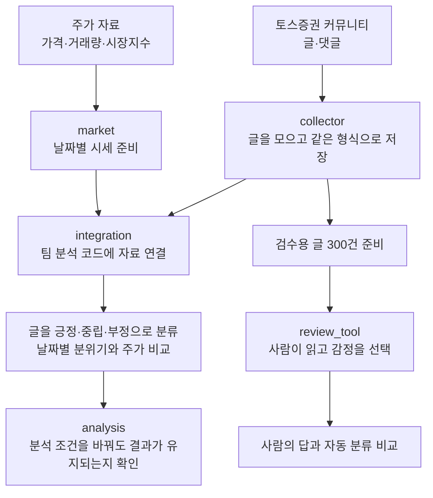
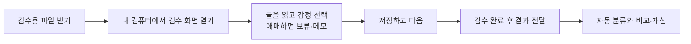

# 주식 게시판의 분위기와 주가를 비교하는 도구

**주식 커뮤니티 글·댓글과 주가 자료를 모아, 게시판 분위기와 주가 움직임이 관련 있는지 살펴봅니다.**

이 폴더의 실제 코드는 [`data_collection/`](data_collection/)에 있습니다.
자료 수집부터 분석 코드 연결, 사람이 글을 확인하는 검수 도구까지 담고 있습니다.
처음 읽는 팀원은 아래 흐름을 먼저 보고, 실행할 때 [상세 안내](data_collection/README.md)를 참고하세요.

## 1. 무엇을 하는 코드인가요?



여기서 **감정 분류**는 글이 해당 종목에 대해 긍정적인지, 중립적인지, 부정적인지 나누는 일입니다.
예를 들어 “앞으로 잘될 것 같아요”는 긍정 표현입니다.
현재 자동 분류는 정해 둔 단어·표현을 사용하므로, 농담이나 맥락이 생략된 댓글을 잘못 판단할 수 있습니다.

## 2. 폴더 이름은 몰라도, 하는 일은 알 수 있어요

| 코드 폴더 | 쉬운 설명 | 예시 |
| --- | --- | --- |
| [collector](data_collection/collector/) | 글과 댓글을 모아 저장 | 같은 글을 중복 저장하지 않고, 중단 후 이어서 수집 |
| [market](data_collection/market/) | 주가 자료를 준비 | 날짜별 가격·거래량을 표로 정리 |
| [integration](data_collection/integration/) | 수집 자료를 팀 분석 코드에 연결 | 글과 주가를 종목·거래일 기준으로 연결하고 검수 표본 준비 |
| [analysis](data_collection/analysis/) | 분석 결과를 추가 점검 | 조건을 바꾸거나 미래 날짜를 예측해 결과 확인 |
| [review_tool](data_collection/review_tool/) | 사람이 글을 확인하는 화면 | 긍정·중립·부정 선택, 애매한 글 보류, 저장·재개 |
| [tests](data_collection/tests/) | 프로그램 동작을 자동 점검 | 저장·날짜 처리·검수 결과 내보내기가 예상대로 되는지 확인 |

감정 분류와 기본 분석에는 저장소 안의 기존 팀 분석 코드를 연결해 사용합니다.
이 폴더는 수집 자료 준비와 연결, 추가 점검, 검수 도구를 제공합니다.

## 3. 현재 어디까지 했나요?

**2026-10-21 기준 기록입니다.**

| 항목 | 상태 |
| --- | --- |
| 대상 종목 | 포스코퓨처엠(003670), 에코프로머티(450080) |
| 자료 기간 | 2026-07-01~10-20, 종목마다 74거래일 |
| 글·댓글 | 수집 7,759건 → 정리 후 분석 7,632건 |
| 예비 분석 | 실행 완료. 감정을 추가했을 때 주가 예측이 개선됐다는 결과는 확인하지 못함 |
| 자동 테스트 | 75개 통과, 합성 자료를 사용한 연결 점검 6단계 통과 |
| 사람 검수 | 글 300건과 도구 준비 완료. 사람 기준 분류 정확도는 아직 미확인 |

**코드가 작동한다는 확인과 감정 분류가 정확하다는 확인은 다릅니다.**
또한 현재 자료는 처음 계획한 3~5종목·약 6개월보다 적어, 연구 전체가 완료된 상태는 아닙니다.

## 4. 다음에 할 일은 무엇인가요?

**사람이 표본 300건을 읽고 자동 분류와 비교할 답을 만드는 것**입니다.



화면의 **부모 글**은 댓글이 달린 원래 글로, 상황을 이해하기 위한 참고입니다.
**검수할 본문**이 지금 감정을 판단할 대상입니다.
검수 결과는 내 컴퓨터에 저장되며, 팀원에게 자동 제출되지는 않습니다.

## 5. 어디서 시작하면 되나요?

| 하고 싶은 일 | 열어 볼 안내 |
| --- | --- |
| 전체 사용 순서 확인 | [data_collection 팀원 안내](data_collection/README.md) |
| 검수 화면 실행·저장·결과 전달 | [검수 도구 실행 안내](data_collection/review_tool/README.md) |
| 긍정·중립·부정 선택 기준 확인 | [검수 명세](data_collection/docs/검수명세.md) |
| 다른 컴퓨터에서 개발 이어가기 | [작업 이관 안내](data_collection/docs/작업이관.md) |
| 왜 이렇게 만들었는지 확인 | [개발기록](data_collection/docs/개발기록.md) |

**GitHub에는 코드와 설명서가 있습니다. 실제 검수 글은 별도로 받아야 합니다.**
검수 파일을 준비한 다음 `김정기/data_collection` 폴더에서 아래 명령으로 화면을 실행합니다.

```bash
python3 -m review_tool.server
```

같은 컴퓨터의 브라우저에서 **http://127.0.0.1:8768** 을 엽니다.
Python이 필요하며, 현재 도구는 Linux/macOS에서 실행합니다. Windows는 WSL 환경이 필요하고 직접 검증하지 않았습니다.
검수만 할 때는 KRX 계정이나 `.env` 설정이 필요하지 않습니다.
입력 파일을 놓을 위치와 설치 방법은 [실행 안내](data_collection/review_tool/README.md)를 따르세요.

## 6. 자료 공유와 개발 위치

- 실제 글·댓글, 검수 결과, 계정 정보는 Git에 올리지 않습니다. 자료는 팀의 비공개 방법으로 전달합니다.
- 개발은 원본 저장소 `devCollegit/social_media_2026`의 `kimjunggee-data-collection` 브랜치에서 진행합니다.
- 토스증권 운영자의 이용 허락 여부는 미확인입니다. 기술적 수집 가능성과 구분하며, [조사 기록](data_collection/docs/수집가능성_점검표.md)에 정리되어 있습니다.
