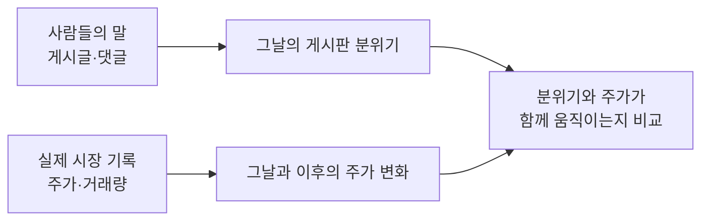
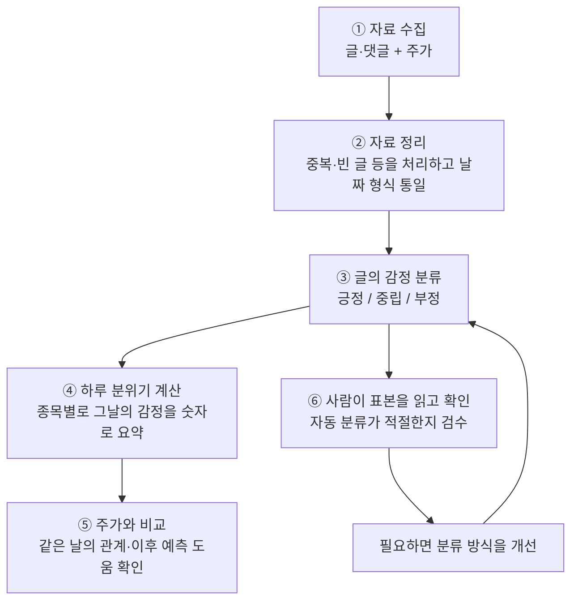
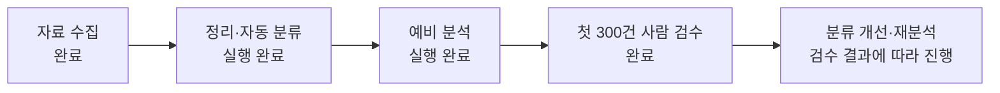
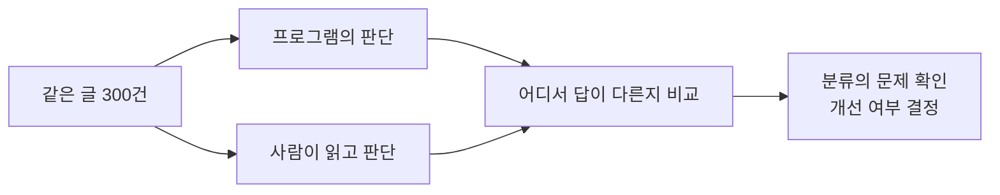

# 주식 게시판의 분위기와 주가 — 프로젝트 안내

> 최신 진행 (2026-10-21): 저비용 LLM 에이전트 300건 파일럿과 병렬 도구 준비 완료. 전체 7,632건은 입력 준비까지만 완료했습니다. 추가 사람 검수는 보류합니다. [파일럿 결과와 다음 단계](data_collection/docs/저비용LLM_파일럿결과.md)

> 2026-10-21 최신 지시: 후속 사람 검수는 재개 지시 전까지 보류합니다. 기존 300건은 불확실성을 포함한 단독 검수자 판단이며 58%는 모델과의 일치율입니다. 관련성·판단유보를 구분하는 재설계를 먼저 검토합니다. [문헌 조사와 개선 방향](data_collection/docs/모호한댓글_연구와개선방향.md)

> 최신 상태 (2026-10-21): 첫 300건 사람 검수 완료. 기존 분류 일치율 58.0%, 실험 후보의 개발 표본 일치율 61.0%. 기본 분류기는 유지하며 후속 300건으로 검증 예정. 자동 테스트 78 passed. [결과와 후속 평가 계획](data_collection/docs/사람검수_후속계획.md)

이 프로젝트의 핵심 질문은 **“주식 게시판의 분위기와 실제 주가 움직임은 관계가 있을까?”**입니다.

사람들이 어떤 종목에 대해 긍정적인 글을 많이 쓰는 날에 주가도 오르는지,
그 분위기가 다음 날 주가를 예측하는 데 도움이 되는지 살펴봅니다.
관계가 발견되더라도 게시판 분위기가 주가를 움직였다는 인과관계까지 입증하는 것은 아닙니다.

실제 코드는 [data_collection/](data_collection/)에 있습니다.
아래에서는 프로젝트의 목적, 진행 과정, 현재 상태와 다음 단계를 설명합니다.

## 1. 무엇을 비교하나요?

서로 다른 두 종류의 자료를 **같은 종목·같은 거래일** 기준으로 연결합니다.
거래일은 주식시장이 열리는 날입니다.



예를 들면 다음과 같은 표를 만듭니다. 아래는 **설명용 가상 예시이며 실제 분석 결과가 아닙니다.**

| 날짜 | 게시판 분위기 | 당일 주가 변화 | 다음 날 주가 변화 |
| --- | --- | --- | --- |
| 첫째 날 | 긍정적인 글이 많음 | 상승 | 상승 |
| 둘째 날 | 부정적인 글이 많음 | 하락 | 상승 |
| 셋째 날 | 중립적인 글이 많음 | 거의 변화 없음 | 하락 |

여러 날짜의 자료를 모아야 정말 관계가 있는지, 우연히 맞은 것인지 확인할 수 있습니다.

## 2. 어떤 순서로 진행하나요?



### ①~② 자료 준비

토스증권 커뮤니티 글·댓글과 시세를 모아 분석하기 편한 표로 만듭니다.
중복 저장을 막고, 날짜와 종목코드의 형식을 맞춰 서로 연결할 수 있게 합니다.

### ③ 감정 분류

각 글이 해당 종목에 대해 긍정적인지, 중립적인지, 부정적인지 나눕니다.
현재는 정해 둔 단어와 표현을 이용합니다.
다만 “참 잘도 오른다” 같은 비꼬는 표현이나 짧은 댓글은 잘못 판단할 수 있습니다.

### ④ 하루 분위기 계산

긍정과 부정 중 어느 쪽이 많은지 숫자로 나타냅니다.

> **설명용 예시:** 하루에 긍정 60건, 중립 20건, 부정 20건이라면<br/>
> 분위기 점수 = (긍정 수 − 부정 수) ÷ 전체 글·댓글 수<br/>
> = (60 − 20) ÷ 100 = **+0.4**

점수가 높을수록 긍정적인 분위기입니다. 중립도 전체 건수에 포함됩니다.
이 점수가 주가 상승 확률을 뜻하는 것은 아닙니다.

### ⑤~⑥ 분석과 확인

분위기가 주가와 관련 있는지 분석합니다.
동시에 그 분위기를 계산할 때 사용한 감정 분류부터 믿을 만한지 사람이 확인합니다.
이 확인 작업을 **검수**라고 부릅니다.

## 3. 현재 어디까지 왔나요?

**2026년 10월 21일 기록 기준**, 자료 수집과 예비 분석은 완료했고,
첫 300건의 사람 검수와 오류 진단을 완료했습니다. 후속 표본으로 후보를 검증할 차례입니다.



| 항목 | 현재 상태 |
| --- | --- |
| 대상 | 포스코퓨처엠·에코프로머티, **2종목** |
| 기간 | **2026-07-01~10-20**, 종목별 74거래일 |
| 글·댓글 | 7,759건 수집 → 정리 후 **7,632건 분석** |
| 프로그램 점검 | 자동 테스트 **78개 통과**, 합성 자료를 사용한 연결 점검 6단계 통과 |
| 사람 검수 | 첫 **300건 완료**, 후속 300건 준비 |
| 사람 기준 분류 정확도 | 첫 표본에서 **58%**, 단독 검수 기준 |
| 전체 연구 범위 | 처음 계획한 3~5종목·약 6개월에는 아직 미달 |

**“분석 실행 완료”는 “연구 결론 확정”을 뜻하지 않습니다.**
프로그램이 오류 없이 작동하는 것과 글의 감정을 정확히 판단하는 것도 서로 다른 확인입니다.

현재 예비 분석에서는 게시판 감정을 추가했을 때 **주가 예측이 더 좋아졌다는 결과를 확인하지 못했습니다.**
일부 관계도 분석 조건에 따라 달라졌습니다.
따라서 지금은 “게시판 분위기로 주가를 예측할 수 있다”고 말할 단계가 아닙니다.

## 4. 사람 검수에서 무엇을 알았고, 다음은 무엇인가요?

분석에 넣은 감정 분류가 틀리면, 그 분류로 만든 하루 분위기 점수도 부정확해질 수 있기 때문입니다.



검수 화면에서 하는 일은 다음과 같습니다.

1. **검수할 본문**을 읽습니다. 댓글이라면 **부모 글**, 즉 댓글이 달린 원래 글을 참고합니다.
2. 해당 종목에 대한 **긍정·중립·부정**을 선택합니다.
3. 판단하기 어렵다면 **보류하고 이유를 적습니다.**
4. 저장한 결과를 자동 분류와 비교합니다.

AI도 300건을 검토했으며 자동 분류와 답이 같았던 비율은 **38%**였습니다.
이는 두 방식의 의견 차이를 보여주는 수치이지, **사람 기준 정확도가 38%라는 뜻은 아닙니다.**

첫 300건을 검수한 결과 기존 분류는 174건(58%)에서 사람과 일치했습니다.
부정으로 검수한 89건 중 77건을 중립으로 놓쳤습니다. 다음은 **고정한 후보를 별도 300건으로 평가하는 것**입니다.
그 결과를 바탕으로 분류 개선 여부를 결정하고 다시 분석합니다.
검수 결과는 내 컴퓨터에 저장되며 팀원에게 자동 제출되지는 않습니다.

## 5. 직접 실행하거나 자세히 알아보려면?

| 하고 싶은 일 | 열어 볼 안내 |
| --- | --- |
| 전체 사용 순서 확인 | [data_collection 팀원 안내](data_collection/README.md) |
| 검수 화면 실행·저장·결과 전달 | [검수 도구 실행 안내](data_collection/review_tool/README.md) |
| 긍정·중립·부정 선택 기준 확인 | [검수 명세](data_collection/docs/검수명세.md) |
| 다른 컴퓨터에서 개발 이어가기 | [작업 이관 안내](data_collection/docs/작업이관.md) |
| 왜 이렇게 만들었는지 확인 | [개발기록](data_collection/docs/개발기록.md) |

**GitHub에는 코드와 설명서가 있습니다. 실제 검수 글은 별도로 받아야 합니다.**
검수 파일을 준비한 다음 `김정기/data_collection` 폴더에서 아래 명령으로 화면을 실행합니다.

```bash
python3 -m review_tool.server
```

같은 컴퓨터의 브라우저에서 **http://127.0.0.1:8768** 을 엽니다.
Python이 필요하며, 현재 도구는 Linux/macOS에서 실행합니다. Windows는 WSL 환경이 필요하고 직접 검증하지 않았습니다.
검수만 할 때는 KRX 계정이나 `.env` 설정이 필요하지 않습니다.
입력 파일을 놓을 위치와 설치 방법은 [실행 안내](data_collection/review_tool/README.md)를 따르세요.

## 6. 자료 공유와 개발 위치

- 실제 글·댓글, 검수 결과, 계정 정보는 Git에 올리지 않습니다. 자료는 팀의 비공개 방법으로 전달합니다.
- 개발은 원본 저장소 `devCollegit/social_media_2026`의 `kimjunggee-data-collection` 브랜치에서 진행합니다.
- 토스증권 운영자의 이용 허락 여부는 미확인입니다. 기술적 수집 가능성과 구분하며, [조사 기록](data_collection/docs/수집가능성_점검표.md)에 정리되어 있습니다.
