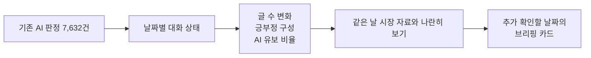

# 종목 커뮤니티 반응 관측 — 시장 브리핑 보조

**팀 공유 데이터:** [7,632행 CSV·컬럼 설명·사용 예제](data_collection/shared/analysis_7632/README.md)를 Git에서 받을 수 있습니다. 본문 6,849건을 포함하고 783건은 공개 검사에 따라 비워 두었습니다.

**많은 게시판 글을 읽는 대신, 어떤 날짜의 대화를 먼저 살펴볼지 정리하는 프로젝트입니다.**

현재 목표는 주가를 맞히는 것보다 **관측 글 수 변화·감정 구성·판단하기 어려운 비율을 함께 보여주는 것**입니다.
2026-10-21 사용자 지시로 목적을 전환했습니다. 이미 AI가 처리한 7,632건을 그대로 사용합니다.

## 1. 시장에서 어떻게 활용하나요?

종목을 조사할 때 다음 질문에 답하는 자료를 만듭니다.

- 어느 날짜에 수집된 대화가 평소보다 많았나?
- 긍정·부정 표현이 한쪽으로 몰렸나, 비슷하게 섞였나?
- AI가 판단한 글은 얼마나 되고, 모호해서 남겨 둔 글은 얼마나 되나?
- 같은 날 주가와 거래량은 어떤 모습이었나?

이 정보를 이용해 **뉴스·공시를 먼저 확인할 날짜를 고르고 브리핑을 작성하는 데 도움을 주려는 시제품**입니다.
실제 투자 수익이나 사용자 판단 개선 효과는 아직 검증하지 않았습니다.

## 2. 실제 예시로 이해하기

**포스코퓨처엠 · 2026-08-07**의 관측 글은 733건으로 직전 기준의 약 19배였습니다.
AI는 긍정 255건, 부정 228건으로 분류했습니다.

평균 감성 점수는 +0.056으로 0에 가깝지만, 단순히 중립이라고 하면 **긍정과 부정 표현이 모두 많이 나왔다는 사실**을 놓칩니다.
새 도구는 평균 점수와 함께 이러한 구성을 보여줍니다.
19배는 수집 표본의 배수이며 전체 투자자의 관심이 19배 늘었다는 뜻은 아닙니다.

## 3. 현재 어디까지 했나요?

| 항목 | 상태 |
| --- | --- |
| 자료 | 포스코퓨처엠·에코프로머티, 2026-07-01~10-20 |
| AI 판정 | 7,632건 전체 완료. 기존 결과를 바꾸지 않음 |
| 날짜별 요약 | 2종목 × 74거래일 = 148개 관측표 |
| 브리핑 예시 | 종목별 관측 활동 배수가 큰 날짜 3개씩, 총 6개 |
| 추가 AI·사람 검수 | 이번 목적 전환에서는 실행하지 않음. 추가 사람 검수 보류 |
| 프로그램 점검 | 자동 테스트 100개 통과 |
| 이전 예측 연구 | 개선 미확인 결과를 별도 기록으로 보존 |

관측 활동 배수는 이전 자료가 최소 10거래일 있어야 계산하므로 현재 128개 종목·거래일에서 표시합니다.
유효한 감정 자료가 부족한 날은 비워 두고 중립으로 채우지 않습니다.

## 4. 그림으로 보는 시제품

왼쪽은 포스코퓨처엠, 오른쪽은 에코프로머티입니다.
위에서부터 관측 활동·시장 거래량 배수, 감정 방향, 긍부정 글의 혼재도, 분류 가능·AI 유보 비율입니다.
맨 위 세로축은 종목마다 범위가 다릅니다.

관측 글 수는 실제 투자자 수가 아니며, AI 유보율도 시장 위험 확률이 아닙니다.
두 종목의 과거 수집 표본에서 관측한 상태를 설명하는 그림입니다.

## 5. 어디서 자세히 볼 수 있나요?

| 궁금한 내용 | 안내 |
| --- | --- |
| 새 목적·계산법·실제 브리핑 예시 | [목적 전환과 시장 브리핑 계획](data_collection/docs/목적전환_시장브리핑.md) |
| 코드 실행과 폴더 설명 | [data_collection README](data_collection/README.md) |
| 이전 예측 분석에서 확인한 것 | [LLM 전체 분석 기록](data_collection/docs/저비용LLM_전체분석.md) |
| 결정과 검증 이력 | [개발기록](data_collection/docs/개발기록.md) |

다음은 날짜별 수집 범위·누락 기록을 점검하고, 팀원이 브리핑 카드를 이해하기 쉬운지 확인하는 단계입니다.
추가 300건의 감정 라벨링은 요구하지 않습니다.

개발은 원본 저장소 `devCollegit/social_media_2026`의 `kimjunggee-data-collection` 브랜치에서 진행합니다.
원본 글·계정 정보는 Git에 올리지 않습니다. 사용자 요청으로 공개 검사한 행별 AI 판정과 제공 가능한 본문만 별도 공유합니다. 다른 팀원 폴더의 코드는 수정하지 않습니다.
