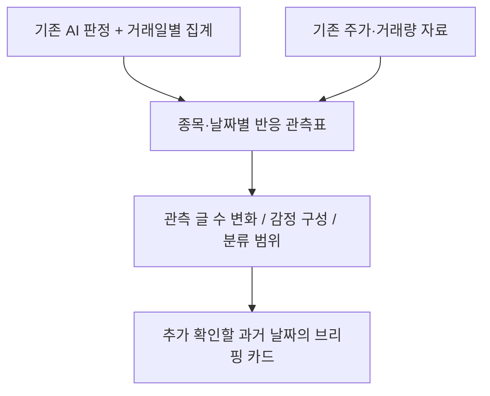

# 종목 커뮤니티 반응 관측 — 코드와 실행 안내

**팀 공유 데이터:** [7,632행 CSV·컬럼 설명·사용 예제](shared/analysis_7632/README.md)를 Git에서 받을 수 있습니다. 본문 6,849건을 포함하고 783건은 공개 검사에 따라 비워 두었습니다.

**수집한 게시판 글을 날짜별로 요약해 시장 브리핑을 돕는 도구입니다.**

2026-10-21 사용자 지시로 주가 예측 중심에서 관측·요약 중심으로 목적을 전환했습니다.
AI가 이미 처리한 7,632건을 그대로 사용하며 추가 사람 검수는 보류합니다.
[새 목적과 활용 예시](docs/목적전환_시장브리핑.md), [프로젝트 한눈에 보기](../README.md)를 먼저 참고하세요.

## 1. 지금 만드는 것은 무엇인가요?



평균 감정만 보여주지 않고 글의 긍부정 혼재도와 판단유보 비율을 함께 표시합니다.
시세는 같은 날의 상황을 이해하는 참고 자료로 사용합니다.
현재는 두 종목·약 3.7개월의 과거 표본 시제품이며 실시간 서비스는 아닙니다.

## 2. 바로 사용할 수 있는 산출물

| 경로 | 내용 |
| --- | --- |
| `state/market_observatory_v1_20261021/daily_profile.csv` | 148개 종목·거래일 관측표 |
| 같은 폴더의 `example_cards.csv`, `브리핑예시.md` | 종목별 3개 날짜, 총 6개 브리핑 예시 |
| 같은 폴더의 `summary.json` | 설정·입력 지문·1.5/2/3배 기준별 선택 수 |
| 같은 폴더의 `observatory.png`, `observatory.svg` | 활동·감정 구성·분류 범위 그림 |

`state/`의 실제 파일은 Git에 없습니다. 원문 없는 집계 그림과 설명은 [목적 전환 문서](docs/목적전환_시장브리핑.md)에 제공합니다.
코드만 다운로드하면 위 결과 파일이 자동으로 생기는 것은 아닙니다.

## 3. 브리핑 도구 실행

기존 정제 자료와 AI 판정을 받은 환경에서 `김정기/data_collection` 폴더로 이동합니다.

```bash
.venv/bin/python -m analysis.market_observatory \
  --daily state/llm_full_20261021/daily_corrected/daily.csv \
  --market state/full_analysis_redacted_20261021/data/interim/market.csv \
  --output state/market_observatory_new
```

이 명령은 저장된 자료만 읽습니다. LLM 호출·네트워크 수집·새 라벨 입력을 하지 않습니다.
기존 출력은 덮어쓰지 않으므로 새 `--output` 경로를 사용합니다.
결과의 활동 배수는 당일을 제외한 이전 최대 20거래일 중앙값으로 계산합니다.
이전 자료가 10일 미만이면 배수는 비워 둡니다.
감정 비중은 유효 글 5건 이상일 때만 표시합니다.

## 4. 개발 환경 준비

```bash
# 김정기/data_collection 폴더에서
python3 -m venv .venv
.venv/bin/pip install -r requirements.txt
.venv/bin/pip install -r ../../조현호/toss_sentiment/requirements.txt
.venv/bin/python -m pytest -q
```

현재 전체 자동 테스트는 **100개**입니다. 기존 팀 분석 코드를 읽기/import하므로 저장소 전체가 필요합니다.
KRX 인증값은 시세를 새로 수집할 때만 사용자가 직접 Git 제외 `.env`에 입력합니다.
브리핑 도구를 실행하는 데 새 계정이나 API 키는 필요하지 않습니다.

## 5. 폴더별 역할

| 경로 | 하는 일 |
| --- | --- |
| `collector/` | 커뮤니티 글·댓글 수집, 정리·저장·이어받기 |
| `market/` | 주가·거래량 등 시장 자료 준비 |
| `integration/` | 분석 연결, 모델 입력 준비·결과 병합 |
| `analysis/market_observatory.py` | 현재 목표인 반응 관측표·브리핑 생성 |
| `analysis/llm_*.py` | 기존 LLM 결과 검증·일별 집계·이전 탐색 분석 |
| `review_tool/` | 사람 검수 도구. 현재 추가 검수는 보류 |
| `tests/` | 자동 동작 검사 |
| `data/`, `state/`, `logs/` | 입력·결과·기록. Git 제외 |

## 6. 과거 결과와 운영 규칙

- [이전 LLM 전체 분석](docs/저비용LLM_전체분석.md): 주가 예측 개선 미확인 결과와 한계 보존
- [사람 검수 명세](docs/검수명세.md), [도구 실행 안내](review_tool/README.md): 검수 재개가 필요할 때 참고
- [수집가능성 점검표](docs/수집가능성_점검표.md): 기술적 수집 가능성과 운영자 허락 여부를 구분한 기록
- [AGENTS.md](AGENTS.md): 수정 범위·데이터 계약·비밀값·Git 규칙
- [개발기록](docs/개발기록.md), [작업이관](docs/작업이관.md): 결정·검증과 다른 환경에서 이어가는 방법

기본 `config.yaml`은 저장된 예제 자료용입니다. 새 수집은 이번 목적 전환에 포함하지 않습니다.
원본 글·인용·검수 결과·계정 정보는 Git에 올리지 않습니다. 사용자 요청으로 공개 검사된 `shared/analysis_7632` 공유본만 예외로 제공합니다.
개발과 push는 원본 저장소 `origin`의 `kimjunggee-data-collection` 브랜치에서 진행합니다.
