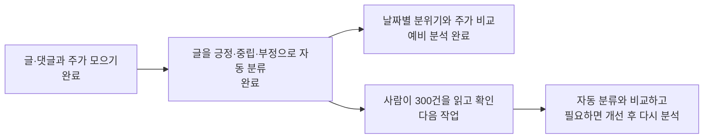
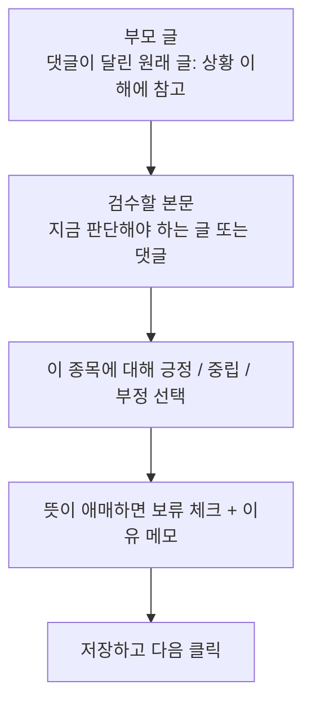
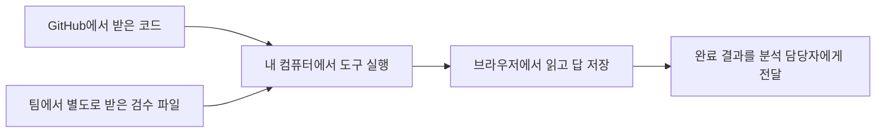

# 주식 커뮤니티 분석 — 팀원 안내

> 최신 상태 (2026-10-21): 첫 300건 사람 검수 완료. 기존 분류 일치율 58.0%, 실험 후보의 개발 표본 일치율 61.0%. 기본 분류기는 유지하며 후속 300건으로 검증 예정. 자동 테스트 78 passed. [결과와 후속 평가 계획](docs/사람검수_후속계획.md)

**주식 게시판의 분위기와 주가 움직임이 관련 있는지 알아보는 프로젝트입니다.**

토스증권 커뮤니티의 글·댓글과 주가 자료를 모아 예비 분석까지 진행했습니다.
첫 300건 사람 검수는 완료했고, 다음은 **실험 후보를 별도 표본으로 평가하는 것**입니다.
이 작업을 이 문서에서는 **검수**라고 부릅니다. 검수 담당자는 팀에서 별도로 정합니다.

## 1. 전체 과정 한눈에 보기



예를 들어 “이 회사 앞으로 잘될 것 같아요”라는 글은 해당 종목에 대한 **긍정** 표현입니다.
프로그램은 정해 둔 단어와 표현을 기준으로 분류하므로, 농담이나 짧은 댓글의 뜻을 잘못 읽을 수 있습니다.
그래서 사람의 확인이 필요합니다.

## 2. 지금 어디까지 했나요?

아래 내용은 **2026-10-21 기준**입니다.

| 궁금한 점 | 현재 상태 |
| --- | --- |
| 어떤 종목을 봤나요? | 포스코퓨처엠(003670), 에코프로머티(450080) |
| 어느 기간인가요? | 2026-07-01~10-20, 종목마다 주식시장이 열린 날 74일 |
| 글은 얼마나 모았나요? | 글·댓글 7,759건을 모아 정리한 뒤 7,632건을 분석 |
| 분석 결과가 나왔나요? | 예비 분석 완료. 게시판 감정을 추가했을 때 주가 예측이 더 좋아졌다는 결과는 확인하지 못함 |
| 프로그램은 작동하나요? | 자동 테스트 78개와 합성 자료를 이용한 연결 점검 6단계 통과 |
| 감정을 정확하게 분류하나요? | 첫 300건에서 사람과 58% 일치. 개선 후보는 후속 검증 필요 |
| 다음 준비물은 있나요? | 검수할 글 300건, 검수 화면, 사용 설명 준비 완료 |

**프로그램이 오류 없이 작동하는 것과 글의 감정을 정확히 판단하는 것은 서로 다른 확인입니다.**

AI도 같은 300건을 검토했지만, 자동 분류와 같은 답을 낸 비율은 38%였습니다.
이 수치는 **사람이 확인한 정확도 점수가 아닙니다.**
현재 자료도 처음 계획한 3~5종목·약 6개월보다 적으므로, 연구 전체가 끝난 상태는 아닙니다.

## 3. 팀원은 무엇을 하면 되나요?

| 맡은 일 | 할 일 | 자세한 안내 |
| --- | --- | --- |
| 수집·도구 제공 | 코드와 검수용 파일 전달 | [작업 이관 안내](docs/작업이관.md) |
| 사람 검수 | 글을 읽고 긍정·중립·부정을 선택, 애매하면 보류 | [검수 기준](docs/검수명세.md), [실행 안내](review_tool/README.md) |
| 분석·보고 | 사람의 답과 자동 분류를 비교하고 연구 결과 정리 | [검수 후 분석 안내](review_tool/README.md#7-분석-담당자가-결과를-연결할-때) |

## 4. 검수 화면에서 무엇을 보나요?



- **부모 글**: 댓글을 이해하기 위한 참고 자료입니다. 여기에 답을 붙이는 것은 아닙니다.
- **검수할 본문**: 이번에 감정을 판단할 대상입니다.
- **“게시글 자체를 검수합니다”**: 댓글이 아닌 독립된 글이므로 아래 본문을 판단하면 됩니다.
- **보류**: 뜻이나 상황을 몰라 답을 확정하기 어렵다는 표시입니다.

예를 들어 본문이 “이거 왜이래요?” 또는 “🙏🙏♥”뿐이면 긍정·부정을 확정하기 어려울 수 있습니다.
부모 글을 참고해도 알 수 없다면 **보류하고 이유를 적습니다.**
자세한 선택 기준은 [검수 명세](docs/검수명세.md)를 따릅니다.

## 5. 검수 도구는 어떻게 실행하나요?

**코드와 검수 파일 두 가지가 필요합니다.** GitHub에서 코드만 받으면 실제 검수 글은 들어 있지 않습니다.



1. [원본 저장소의 개발 브랜치](https://github.com/devCollegit/social_media_2026/tree/kimjunggee-data-collection)에서 코드를 받습니다.
2. 제공자에게 검수 파일 묶음인 `review-handoff-20261021.zip`을 별도로 받습니다.
3. 압축을 풀고 `review.csv`와 `manifest.json`을 다음 폴더에 넣습니다.

```text
김정기/data_collection/data/labels/human_review_context_20261021/
```

4. 터미널에서 `김정기/data_collection` 폴더로 이동한 뒤 실행합니다.

```bash
python3 -m review_tool.server
```

5. 같은 컴퓨터의 브라우저에서 **http://127.0.0.1:8768** 을 엽니다. 터미널은 켜 둡니다.
6. 검수자 이름 또는 별칭을 입력하고, 답을 선택한 뒤 **저장하고 다음**을 누릅니다. 선택만 하면 저장되지 않습니다.

검수 도구는 Python이 설치된 Linux/macOS에서 실행합니다. 개발·테스트에는 Python 3.13을 사용했습니다.
Windows는 WSL이라는 Linux 실행 환경이 필요하며, Windows에서의 접속은 직접 검증하지 않았습니다.
검수만 할 때는 KRX 계정이나 `.env`, 추가 Python 패키지가 필요하지 않습니다.

처음 설치하거나 오류가 나면 [단계별 실행 안내](review_tool/README.md)를 확인하세요.
독립 검수자가 여러 명이면 각자 다른 컴퓨터 또는 별도의 저장 폴더를 사용합니다.

## 6. 쉬었다가 이어 하거나 결과를 전달하려면?

- **잠깐 종료**: 먼저 저장한 뒤 터미널에서 `Ctrl+C`를 누릅니다.
- **다시 시작**: 같은 입력 파일과 저장 폴더를 사용해 같은 명령을 실행합니다.
- **모두 완료**: 미입력·보류 항목을 해결한 뒤 **평가용 CSV 내보내기**를 누릅니다.
- **결과 전달**: 내보낸 CSV와 같은 이름의 JSON, `progress.json`, 검수 조건 설명을 분석 담당자에게 전달합니다.

기본 저장 폴더는 `data/labels/human_review_session/`입니다.
CSV는 표 형태의 결과 파일이고, JSON은 검수 이력 등을 담은 보조 파일입니다.
저장은 내 컴퓨터에 이루어지며 팀원에게 자동 제출되지 않습니다.

보류가 해결되지 않았다면 답을 억지로 채우지 말고, 진행 파일과 보류 이유를 전달하세요.
제출 파일과 완료 기준은 [검수 명세](docs/검수명세.md)에 있습니다.

## 7. 실제 글과 계정 정보는 GitHub에 올리지 않습니다

글에는 개인을 알아볼 수 있는 표현이나 개인 투자정보가 남아 있을 수 있습니다.
**검수 입력·결과는 팀에서 정한 비공개 방법으로 전달합니다.**
현재 로컬 전달 묶음은 `data/exports/review-handoff-20261021.zip`이며 Git에는 없습니다.

`.env`의 계정 정보와 AI의 답안은 검수자에게 전달하지 않습니다.
독립적으로 검수할 사람에게 다른 검수자의 답도 미리 보여주지 않습니다.

## 8. 코드를 수정하는 사람을 위한 안내

일반 검수자는 이 절의 명령을 실행할 필요가 없습니다.

현재 개발 기준은 **원본 저장소 `devCollegit/social_media_2026`**입니다.
`kimjunggee-data-collection` 브랜치에서 작업하고 `origin`으로 push합니다.

```bash
# 김정기/data_collection 폴더에서 실행
python3 -m venv .venv
.venv/bin/pip install -r requirements.txt
.venv/bin/pip install -r ../../조현호/toss_sentiment/requirements.txt
.venv/bin/python -m pytest -q
```

마지막 줄에 `78 passed`가 나오면 현재 78개 자동 테스트를 통과한 것입니다.
실행 시간은 컴퓨터마다 다릅니다. 테스트를 추가하면 개수도 달라집니다.

| 폴더 | 하는 일 |
| --- | --- |
| `collector/` | 커뮤니티 글·댓글 수집 및 저장 |
| `market/` | 주가·거래량 등 시세 자료 준비 |
| `integration/` | 수집 결과를 분석 코드와 연결 |
| `analysis/` | 분석 조건에 따라 결과가 달라지는지 확인 |
| `review_tool/` | 사람이 사용하는 검수 화면 |
| `tests/` | 프로그램 동작을 자동으로 확인 |
| `data/`, `state/`, `logs/` | 실제 자료·진행 상태·실행 기록. Git 제외 |

기본 `config.yaml`은 저장된 예제 자료를 사용하는 설정입니다.
`config.research.yaml`은 실제 API 요청용 설정이므로 실행 전 [AGENTS.md](AGENTS.md)를 확인합니다.
토스증권 운영자의 이용 허락 여부는 미확인입니다. 조사 내용은 [수집가능성 점검표](docs/수집가능성_점검표.md)에 있습니다.

시세 수집용 KRX 계정은 사용자가 직접 Git 제외 `.env`에 입력합니다.
파일 형식·설정·수집 규칙은 [AGENTS.md](AGENTS.md), 변경 이유와 검증 기록은 [개발기록](docs/개발기록.md)을 참고하세요.
