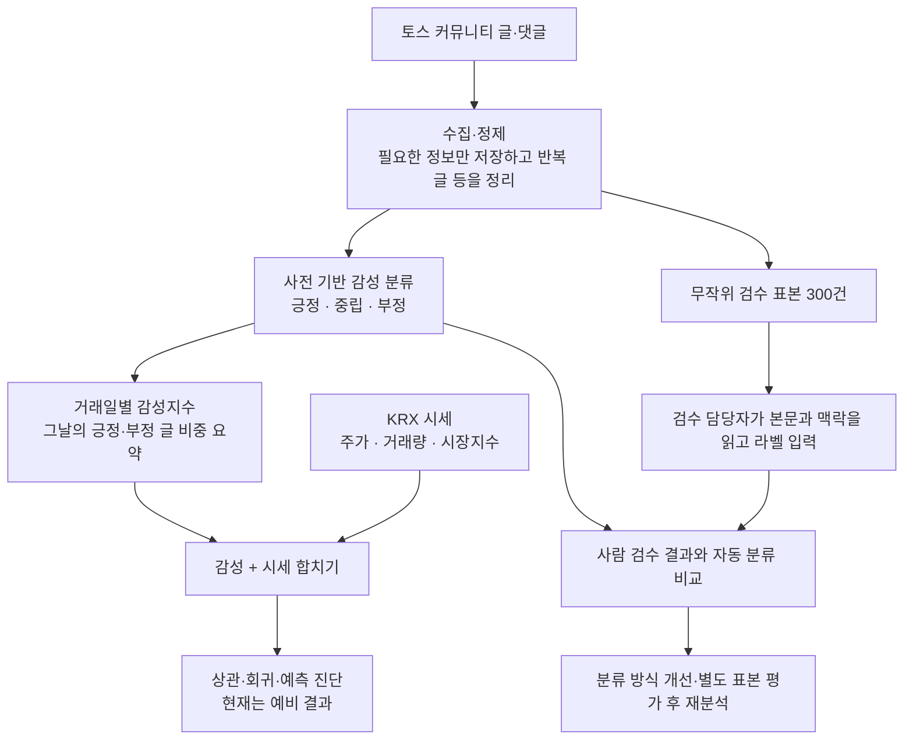
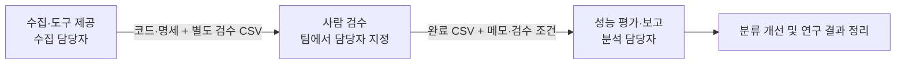
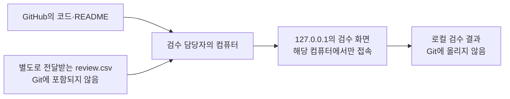

# 커뮤니티 데이터 수집·분석과 감성 검수 안내

이 프로젝트는 **주식 커뮤니티 글의 감정과 주가 움직임이 어떤 관계인지** 살펴보는 팀 과제다.
이 폴더는 글·댓글과 시세를 모으고, 분석용 파일을 만들며, 사람이 감정 분류를 확인할 수 있는 도구를 제공한다.

**수집 담당자는 데이터·코드·도구·문서를 제공한다. 사람 검수는 팀에서 별도로 지정할 검수 담당자의 업무다.**
현재 데이터로 예비 분석은 실행했지만, 감정을 정확하게 분류하는지는 사람 검수로 확인해야 한다.

## 처음 읽는 팀원은 여기서 시작

| 하고 싶은 일 | 읽을 문서 |
| --- | --- |
| 프로젝트가 무엇인지 이해하기 | 이 README의 흐름도와 현재 상태 |
| 무엇을 어떻게 검수할지 알기 | [검수 업무 명세](docs/검수명세.md) |
| 내 컴퓨터에서 검수 화면 열기 | [검수 도구 실행 README](review_tool/README.md) |
| 수집·분석의 결정과 변경 이력 확인 | [개발기록](docs/개발기록.md), [작업이관](docs/작업이관.md) |
| 코딩 에이전트로 코드 수정하기 | [AGENTS.md](AGENTS.md) |

## 전체 흐름: 글이 어떻게 연구 결과가 되는가?



사전 기반 분류는 정해 둔 단어·표현으로 감정을 계산하는 기준선이다. 사람이 읽는 것처럼 맥락을 모두 이해하지는 못한다.
감성지수는 `(긍정 수 − 부정 수) ÷ 전체 글·댓글 수`로 계산한다. 중립도 분모에 포함된다.
글은 종가 시각 15:30을 기준으로 거래일에 배정하며, 시세 달력의 마지막 거래일 뒤에 배정될 글은 분석에서 제외된다.

## 현재 어디까지 완료했나? (2026-10-21 기록)

| 영역 | 현재 결과 | 해석 |
| --- | --- | --- |
| 수집 | 300종목 예비 조사 후 최종 2종목 선정 | 포스코퓨처엠 003670, 에코프로머티 450080 |
| 분석 기간 | 2026-07-01~10-20, 종목별 74거래일 | 원고 목표 3~5종목·약 6개월에는 아직 미달 |
| 글·댓글 | 원자료 7,759건 → 정제 7,632건 | 본문 멘션 제거 후 최신 결과 |
| 분석 표 | 2종목 × 74거래일 = 148행 | 종목·거래일별 감성 관측률 100% |
| 프로그램 검증 | 테스트 75개, 합성 연동 6단계 통과 | 프로그램 동작 확인이며 감성 정확도 보증은 아님 |
| AI 예비 검토 | 300건 중 사전과 114건 일치, 38.0% | **사람 정답 기준 정확도가 아님** |
| 사람 검수 | 도구·맥락 포함 표본·명세 준비 | 담당자가 입력하고 결과를 제출해야 함 |
| 분석 결론 | 일부 관계는 분석 조건에 따라 달라짐 | 감성을 추가한 순차 예측의 개선은 확인되지 않음 |

**관측률 100%**는 분석할 날짜에 글이 충분하다는 뜻이다. **분류 정확도 100%**라는 뜻이 아니다.
검수 현황은 각 담당자의 로컬 저장 상태로 확인한다. 이 문서의 준비 완료를 사람 검수 완료로 읽지 않는다.

## 역할과 전달물



한 사람이 여러 업무를 맡을 수 있지만, **수집 담당자의 업무에 사람 라벨링을 포함하지 않는다.**
이 인계는 문서 준비이며 팀원에게 파일이나 메시지를 자동 전송하는 동작은 아니다.

## 코드와 데이터는 따로 전달한다



현재 코드 저장소는 공개 저장소다. 검수 원문을 여기에 push하면 팀 외부에서도 열람할 수 있다.
본문과 부모 글에는 자유 서술 개인정보·개인 투자정보가 남을 수 있어 현재 원문은 공개 Git에 올리지 않는다.
팀 전용 비공개 저장소나 접근 제한 파일 공유로 전달할 수 있다. 비공개 전달도 필요한 최소 파일만 포함한다.
저장소를 clone하는 것만으로 실제 글·댓글이나 검수 표본이 생기지는 않는다.
검수 담당자에게는 아래 파일을 팀이 정한 비공개 방법으로 별도 전달해야 한다.

- `data/labels/human_review_context_20261021/review.csv` — 부모 맥락 포함 미라벨 검수 표본
- 같은 폴더의 `manifest.json` — 생성 시 입력 지문과 맥락 연결 건수
- 실행 방법과 검수 기준은 Git의 README·명세로 제공

로컬 전달 묶음은 `data/exports/review-handoff-20261021.zip`이다. 파일 자체는 Git에 없으며
`review.csv`, `manifest.json`, 전달 안내만 포함한다. 이 묶음도 공개 링크로 배포하지 않는다.

`.env`와 KRX 계정, 기존 검수자의 `progress.json`, AI 라벨 파일은 신규 독립 검수자에게 함께 넘기지 않는다.
원자료의 구조화된 닉네임·프로필 ID 멘션은 제거했지만 자유 서술의 개인정보까지 완전 제거했다고 보장하지 않는다.

## 검수 도구 실행 요약

현재 도구는 `fcntl`을 사용하므로 **Linux/macOS에서 실행**한다. Windows는 WSL 환경이 필요하다.
개발·테스트 환경은 Python 3.13이다. 검수 도구만 실행할 때는 Python 표준 라이브러리만 사용하며
KRX 로그인, `.env`, 별도 Python 패키지 설치가 필요하지 않다.

```bash
# 저장소 루트에서
cd 김정기/data_collection
python3 -m review_tool.server
```

입력 CSV를 준비한 뒤 실행하고, **실행한 컴퓨터의 브라우저**에서 `http://127.0.0.1:8768`을 연다.
상세 설치, 개인별 저장 폴더, 종료·재개, 오류 해결은 [실행 README](review_tool/README.md)를 따른다.

## 개발·분석을 이어갈 때

```bash
# 김정기/data_collection 안에서 실행
python3 -m venv .venv
.venv/bin/pip install -r requirements.txt
.venv/bin/pip install -r ../../조현호/toss_sentiment/requirements.txt
.venv/bin/python -m pytest -q
```

시세를 새로 수집할 때만 `.env.example`을 `.env`로 복사해 **본인이 직접** KRX 인증값을 입력한다.
기존 셸 환경변수가 `.env`보다 우선하며 실제 인증값을 Git·문서·로그에 남기지 않는다.

`config.yaml`의 기본 커뮤니티 source는 fixture다. `config.research.yaml`은 실제 공개 API에 요청하는 별도 설정이다.
검수 담당자는 수집 명령을 실행할 필요가 없다. 수집은 요청 간격·예산·오류 중단을 적용한다.
토스증권 운영자의 이용 허락 여부는 미확인이며 비로그인 API의 기술적 동작과 구분한다.
자세한 기록은 [수집가능성 점검표](docs/수집가능성_점검표.md)에 있다.

## 주요 폴더와 파일 형식

| 경로 | 역할 |
| --- | --- |
| `collector/` | 목록·댓글 수집, 파서, 저장·재개, 활동량 조사 |
| `market/` | KRX/FDR 시세·종목 메타데이터 |
| `integration/` | 외부 분석 코드 읽기/import, 격리된 연동 실행, 검수 표본 생성 |
| `analysis/` | 통계 민감도·시계열 진단·AI 일치도 비교 |
| `review_tool/` | 사람이 사용하는 검수 웹 화면과 로컬 서버 |
| `tests/` | 합성 데이터 기반 자동 테스트 |
| `data/`, `state/`, `logs/` | 실제 입력·결과·상태. **Git 제외** |

커뮤니티 CSV의 필수 컬럼은 `stock_id, post_id, parent_id, text, created_at`이다.
종목·글 ID는 문자열로 보존하고, 작성 시각은 KST 고정 형식을 쓴다.
검수 입력·완료 파일의 컬럼은 [검수 명세](docs/검수명세.md)에, 수집기 전체 출력 계약은 [AGENTS.md](AGENTS.md)에 있다.

현재 개발 저장소는 [팀 원본 저장소](https://github.com/devCollegit/social_media_2026/tree/kimjunggee-data-collection)이며, `kimjunggee-data-collection` 브랜치에서 작업하고 origin으로 push한다. 개인 fork는 개발 대상으로 사용하지 않는다. 이번 요청은 commit/push이며 PR 생성은 포함하지 않는다.
