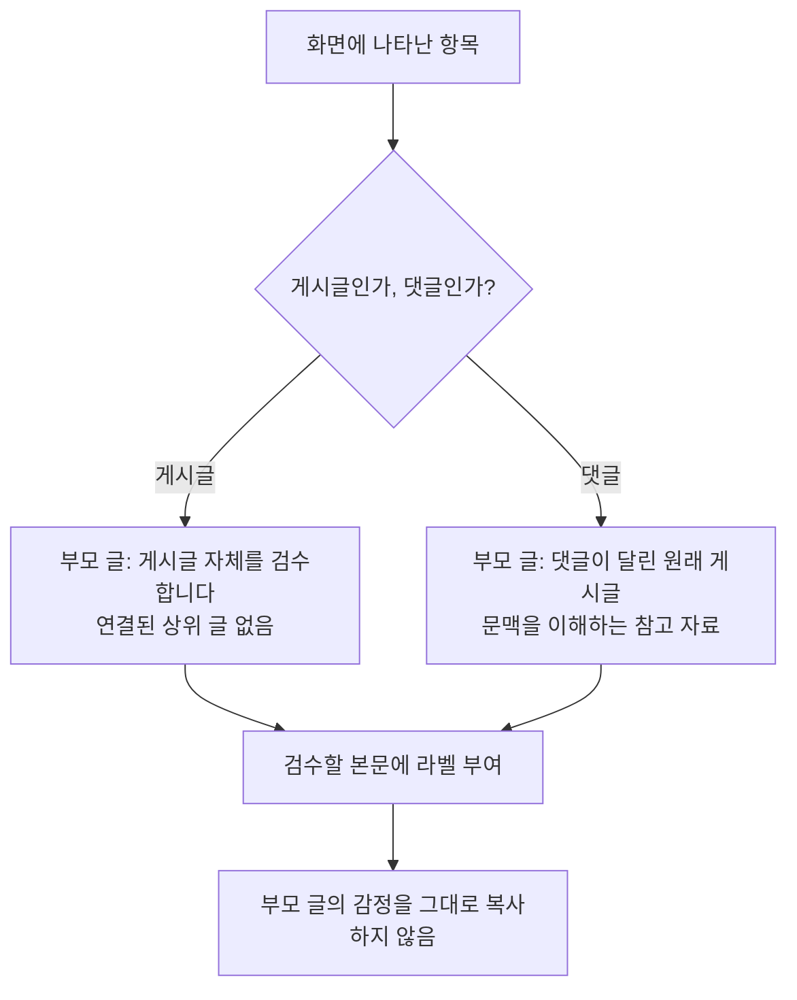
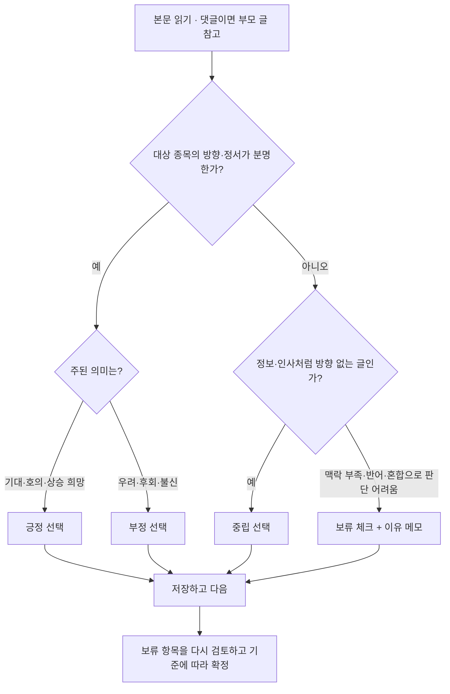
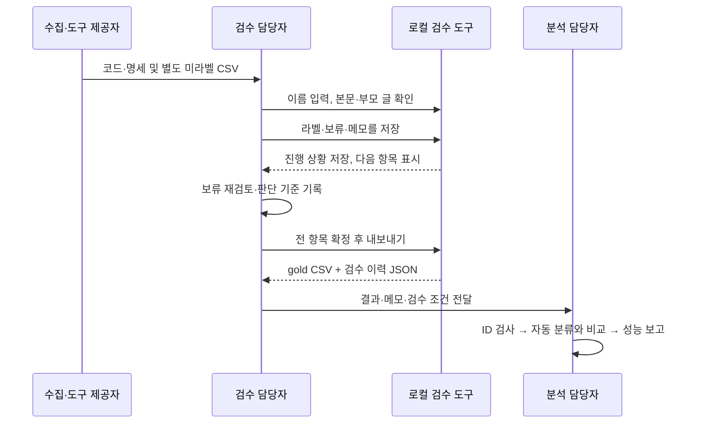

# 사람 감성 검수 업무 명세

버전: 1.0 / 작성: 2026-10-21 / 대상: 팀에서 지정할 검수 담당자와 결과를 받을 분석 담당자.
**수집 담당자는 데이터·도구·문서를 제공하고, 별도의 검수 담당자가 사람 라벨을 작성한다.**
검수 담당자 실명과 인원은 팀에서 지정하며, 아래 기준을 검수 시작 전에 함께 확인한다.

## 1. 목적과 검수 단위

검수 목적은 자동 분류가 글의 감정을 적절하게 포착하는지 평가할 사람 라벨을 확보하는 것이다.
주가를 맞히거나 투자 판단을 하는 작업이 아니다. 한 건은 **게시글 1개 또는 댓글 1개**다.
검수할 본문을 라벨링하며, 부모 글은 댓글을 이해하기 위한 참고 자료다.

| 용어 | 쉬운 설명 |
| --- | --- |
| 라벨 | 글에 붙이는 `긍정`, `중립`, `부정` 표시 |
| 부모 글 | 댓글이 달린 원래 게시글. 이것 자체가 현재 평가 대상인 것은 아님 |
| 검수할 본문 | 이번에 라벨을 붙일 정확한 글·댓글 |
| 보류 | 아직 확정하지 못했다는 작업 상태. 네 번째 감성 라벨이 아님 |
| gold CSV | 사람 검수 완료 라벨을 분석에 넘기는 파일명 관례. 절대적 진실을 의미하지 않음 |

## 2. 입력 자료

준비된 검수 표본은 2종목에서 뽑은 300건이다. 게시글 173건, 댓글 127건이며
정제된 자료에서 부모 글을 연결한 댓글은 126건, 미연결은 1건이다.
현재 표본은 AI 진단에도 쓰였으므로 모델 개선용 진단 표본과 최종 독립 평가 표본을 구분해야 한다.

검수 담당자가 받을 파일: `data/labels/human_review_context_20261021/review.csv`.

| 컬럼 | 의미 |
| --- | --- |
| `stock_id` | 대상 종목 코드(앞자리 0 보존) |
| `post_id` | 이번 글·댓글 ID |
| `parent_id` | 댓글의 부모 ID. 게시글은 빈 값 |
| `text_norm` | 검수할 본문 |
| `parent_text` | 참고할 부모 글. 없으면 빈 값 |
| `context_status` | `top_level` 게시글 / `parent_available` 부모 연결 / `parent_missing` 부모 미연결 |
| `label`, `review_note` | 준비된 CSV에서는 빈 값. 도구는 별도 진행 파일에 입력값 저장 |

도구는 CSV에 AI 라벨이 추가돼 있어도 읽어 화면에 전달하지 않는다. 검수자는 AI 결과와 이후 주가를
미리 보지 않는다. ID·본문·파일 순서를 직접 바꾸지 않는다. 입력 파일 지문이 달라지면 기존 작업과 합칠 수 없다.

## 3. 분류 기준

**본문에 드러난 대상 종목에 대한 정서·평가를 기준으로 한다.** 희망과 확신은 서로 다를 수 있지만
상승을 바라는 표현도 이 명세에서는 긍정에 포함한다. 실제 미래 수익률로 라벨을 정하지 않는다.
다른 이용자에 대한 감사·욕설과 대상 종목에 대한 평가를 구분한다.

| 라벨 | 포함 기준 | 합성 예시 |
| --- | --- | --- |
| 긍정 | 상승 기대·회복 희망, 기업 전망이나 매수에 호의적 | “실적이 좋아져 더 오를 것 같다”, “제발 올라줘” |
| 중립 | 방향 없는 정보·질문·인사, 단순 수치·매매 사실 | “오늘 발표가 몇 시인가요?”, “외인 순매수 수치입니다” |
| 부정 | 하락 예상, 손실 후회, 기업 불신·두려움 | “계속 내려서 산 것을 후회한다” |

### 애매한 사례 처리

| 상황 | 1차 처리 | 메모 예시 |
| --- | --- | --- |
| 매매동향 숫자 글에 `🙏♥` 댓글 | 잠정 중립 + 보류 | `[맥락부족] 감사인지 상승 희망인지 불명확` |
| 부모 없는 “이거 왜이래요?” | 잠정 중립 + 보류 | `[맥락부족] 질문 대상·상황 불명` |
| 주가 상승과 손실 불만이 함께 있음 | 우세한 의미가 분명하면 해당 라벨, 아니면 보류 | `[혼합] 회복 희망과 손실 불만 공존` |
| 다른 이용자에게 감사 인사 | 대상 종목의 방향성이 없으면 중립 | `[방향없음] 대인 감사` |
| 매수·매도 수량이나 수익률만 적음 | 수치로 확인 가능한 뜻과 정서를 구분, 불명확하면 보류 | `[맥락부족] 수치의 의미 불명` |
| 다른 종목 이야기만 있음 | 현재 대상 종목 기준 중립 | `[관련성부족] 다른 종목 언급` |
| 반어·풍자 | 문맥으로 확실하면 의도에 맞게 분류, 아니면 보류 | `[반어] 해석 확정 어려움` |

“매동”은 매매동향, “외인”은 외국인 투자자, “프매”는 프로그램 매매의 줄임말이다.
수치의 단위나 부호 기준이 없으면 주가 전망을 임의로 추론하지 않는다.
이모지 자체의 호감과 종목에 대한 상승 기대는 동일하지 않다.

### 보류를 최종 처리하는 규칙

1. 부모 글과 검수 기준을 다시 확인한다. 추가 맥락이 없다면 사실을 추측하지 않는다.
2. 담당자가 방향을 확정할 수 있으면 라벨과 메모를 수정하고 보류를 해제한다.
3. 끝까지 방향을 판정할 수 없는 항목은 검수·분석 담당자가 처리 기준을 합의한다.
   이 명세의 제안은 **중립 + `[판단불가]` 메모**로 기록하고, 분석에서 일반 중립과 구분해 포함/제외 민감도를 확인하는 것이다.
   이는 “감정이 없다”는 단정이 아니며 담당자의 기준 확인 전 자동 적용하지 않는다.
4. 합의하지 못한 경우 보류를 유지한다. 내보내기를 위해 임의로 라벨을 확정하지 않는다.
   `progress.json`과 보류 목록을 미완료 산출물로 전달한다. 현재 도구는 보류가 있으면 gold 내보내기를 차단한다.

`[판단불가]` 등 메모는 도구의 자유 입력 규칙이며 자동 제외 기능이 아니다.
내보낸 gold에는 메모가 없으므로 분석 담당자는 함께 전달된 진행 파일에서 해당 ID를 식별해야 한다.

## 4. 수행 절차와 역할

- 수집 담당자: 데이터·코드·문서 제공. 사람 정답 작성과 역할을 구분한다.
- 검수 담당자(팀에서 지정): 표본 확인, 라벨 작성, 보류 처리, 결과 제출.
- 분석 담당자(팀에서 지정): 결과 입력 검사, 성능 평가, 한계 보고와 재분석.
- 원고의 두 사람 독립 라벨링 계획을 유지한다면 두 검수자가 서로의 라벨을 보기 전에 각각 완료한다.
  같은 미라벨 입력을 사용하되 별도 출력 폴더를 쓴다. 단독 검수로 바꾸면 변경 사실을 보고하고 평가자 간 일치도를 주장하지 않는다.

## 5. 완료 조건과 제출물

| 구분 | 완료 조건 |
| --- | --- |
| 입력 | 동일한 300건, stock_id/post_id 보존, 중복·누락 없음 |
| 라벨 | 긍정·중립·부정 중 하나가 모두 저장됨 |
| 보류 | 0건. 판단불가 처리 방식과 이유는 메모·검수 조건에 기록 |
| 이력 | 실제 검수자, 기준 버전, 날짜, 검수 인원·절차 기록 |
| 제출 | gold CSV + 같은 이름의 JSON + progress.json + 검수 조건 설명 |

실행 경로와 실제 파일명은 [실행 README](../review_tool/README.md)를 참고한다.
제출물에 본문·메모가 포함될 수 있으므로 Git에 올리지 않고 팀이 정한 비공개 방식으로 전달한다.
검수 담당자가 작성할 검수 조건 설명에는 다음 항목을 포함한다.

- 검수자/검수 기간/단독 또는 독립 2인 여부
- 적용한 기준: 이 명세 v1.0 및 수정한 기준
- 원문만 본 것인지, 부모 글도 참고했는지
- AI 라벨·가격 정보를 미리 보았는지
- 판단불가·혼합·관련성 부족의 처리 방식과 건수
- 중도 제외·누락이 있으면 ID와 이유 (300건 완료로 표시하지 않음)

## 6. 분석 담당자의 후속 검증

내보내기 성공은 파일 완성을 뜻하며 분류 성능이 충분하다는 뜻은 아니다.

1. 입력 표본과 결과 ID의 집합이 같고, 300건 모두 유일하며, 라벨 값이 허용 범위인지 확인한다.
2. 메모의 판단불가·혼합·관련성 부족 항목을 별도로 집계한다.
3. 분석 설정 **복사본**의 `sentiment.gold_path`를 내보낸 CSV의 절대 경로로 지정한다.
4. 자동 예측과 모든 ID가 연결되는지 확인한 후 클래스별 표본 수, precision/recall, macro-F1, 혼동행렬, 정확도를 보고한다.
5. 두 사람이 독립 검수했다면 조정 전 일치도와 조정 절차도 기록한다. 현재 도구는 두 파일의 자동 합의 기능을 제공하지 않는다.
6. 개선에 사용한 300건을 최종 독립 평가로 재사용하지 않는다. 별도 평가 표본 검증을 구분해 보고한다.

현재 외부 감성 평가기는 `post_id`로만 병합하고 매칭된 행으로 계산한다.
도구는 중복 post_id를 거부하지만 **분석 담당자는 미매칭·라벨 누락을 별도로 확인**해야 한다.
또한 `[판단불가]` 메모를 외부 평가기가 자동 제외하지 않으므로 평가 범위를 명시한다.
프로그램 테스트 75개 통과, AI와의 38% 일치율, 거래일 관측률 100% 중 어느 것도 사람 정답 기준 정확도를 대신하지 않는다.
