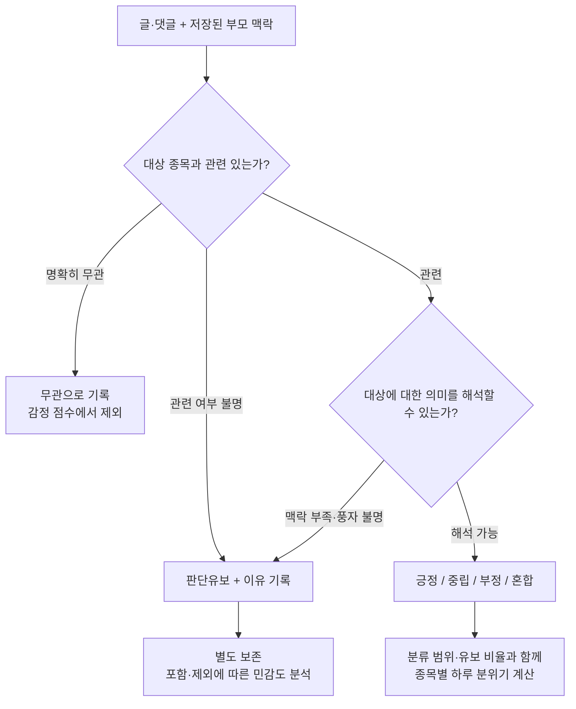

# 모호한 댓글을 고려한 연구·검수 개선 방향

2026-10-21 사용자 피드백 반영. **후속 300건 검수는 사용자 재개 지시 전까지 보류한다.**
기존 라벨과 검수 진행 파일은 보존하고, 아래 설계를 먼저 검토한다.
이 문서는 문헌 조사와 프로젝트 적용 제안이며 새 분류 체계가 구현됐다는 뜻은 아니다.

## 1. 현재 수치를 어떻게 읽어야 하나?

첫 300건에서 사람과 기존 사전은 58%, 후보는 61% 일치했다.
이는 단독 검수자의 판단과 비교한 수치이며 객관적 진실에 대한 정확도로 확정할 수 없다.
불일치 126건을 모두 모델 오류로 부른 이전 표현은 이 문서에서 정정한다.
불일치에는 모델 오류, 라벨 실수, 기준 차이, 복수의 타당한 해석, 맥락 부족이 섞일 수 있다.
보류가 0건이라는 사실도 원래 문장이 명확했다는 증거는 아니다.
현재 메모만으로 모호한 글 수를 복원할 수 없으므로 임의로 추정하지 않는다.

단어 규칙을 추가한 후보는 개발용 가설로만 남긴다.
58%에서 61%로 오른 결과를 검증된 개선으로 해석하거나 기본 분류기를 교체하지 않는다.

## 2. 관련 분야에서도 해결 방법을 연구하고 있나?

| 문헌 | 확인한 내용 | 이 프로젝트에 적용할 제안 |
| --- | --- | --- |
| [Fin-SoMe, Chen 외, 2020](https://aclanthology.org/2020.lrec-1.749/) | 금융 SNS 1만 건을 전문가가 주석. 작성자 감정과 시장 감정이 다를 수 있고 작성자 라벨도 오해를 줄 수 있음 | 개인 손실의 슬픔·대인 욕설과 종목 전망을 구분 |
| [SemEval 금융 감성 과제, Cortis 외, 2017](https://aclanthology.org/S17-2089/) | 문장에 언급된 각 회사·종목을 대상으로 감성을 평가 | 게시판 전체 기분보다 해당 종목을 향한 평가를 측정 |
| [LeWiDi, Leonardelli 외, 2023](https://aclanthology.org/2023.semeval-1.314/) | 감성 등 주관적 과제에서 의견 차이를 단일 정답으로 없애기보다 보존하고 분포로 평가 | 가능하면 개별 평가 기록·불확실성을 보존. 한 사람 라벨로 확률 분포를 만들지는 않음 |
| [대화 맥락과 풍자, Ghosh 외, 2017](https://aclanthology.org/W17-5523/) | 해당 실험에서 댓글만 읽는 모델보다 대화 맥락을 함께 읽는 모델이 풍자 탐지에 유리 | 이미 저장된 부모 글·댓글을 함께 보되 부모 감정을 복사하지 않음 |
| [선택적 분류, Geifman·El-Yaniv, 2017](https://arxiv.org/abs/1705.08500) | 불확실한 사례의 예측을 거부하고 정확성과 처리 범위를 함께 평가하는 방법 | 판단유보를 허용하고 분류한 비율·제외한 비율·분류 성능을 함께 보고 |

이 연구들이 한국어 토스 댓글을 완벽히 해결했다는 뜻은 아니다.
선택적 분류 논문의 실험은 이미지 과제이므로 그 성능 보장을 우리 자료에 옮길 수 없다.
여기서는 불확실한 입력에 답을 강요하지 않는 설계 원칙을 참고한다.

## 3. 우선 바꿀 것은 감정 사전보다 분류 순서

**중립·무관·판단유보는 서로 다르다.**

| 예시: 실제 자료가 아닌 설명용 | 권장 처리 |
| --- | --- |
| 오늘 이 회사 실적 발표가 몇 시인가요? | 관련 + 중립: 종목에 관한 방향 없는 질문 |
| 점심 뭐 먹지? | 무관: 대상 종목에 관한 판단이 아님 |
| 이거 왜 이래요? | 대상·상황이 드러나지 않으면 판단유보 |
| 참 잘도 오르네 | 부모 맥락으로 반어가 확인되면 의도대로, 확인 불가면 판단유보 |
| 손실은 있지만 다음 분기 회복이 기대돼요 | 현재 손실 감정과 미래 전망을 분리해 기록. 정의에 따라 혼합 또는 미래 전망 긍정 |

측정 대상도 먼저 고정한다. 제안은 **해당 종목에 대한 평가·상승 또는 하락 기대**다.
과거 손실에 대한 감정, 미래 가격 전망, 다른 이용자에 대한 감정은 별도일 수 있다.
단순히 욕설이 있다는 이유로 종목 부정으로 처리하지 않는다.

## 4. 검수 도구 개선 제안: 아직 미구현

- 먼저 관련 여부를 관련·무관·불명 중 선택한다.
- 감정과 별도로 판단 가능 여부와 이유를 기록한다: 맥락 부족·풍자·혼합·대상 불명 등.
- 무관·판단유보는 확정된 작업 결과로 내보낼 수 있게 한다. 억지로 중립을 채우지 않는다.
- 관련성이 있고 판단 가능한 행만 기존 분석기용 긍정·중립·부정 CSV로 변환한다.
- 전체 판정 내역은 별도 파일로 보존해 제외 이유와 분모를 재현한다.
- 기존 progress.json·첫 300건 CSV를 자동 변환하거나 덮어쓰지 않는다.

현재 도구는 3개 감정과 임시 보류만 지원하고 보류가 남으면 gold 내보내기를 막는다.
따라서 현 도구에서 '판단유보'를 완결된 판정으로 다루는 기능은 추가 구현이 필요하다.
기존 명세의 '판단불가를 중립으로 저장하는 제안'과 무관 글을 중립으로 보는 규칙은
향후 v2 설계에서는 채택하지 않는다. 기존 라벨을 소급 변경하지는 않는다.

## 5. 추가 검수 없이 지금 진행할 수 있는 일

1. 기존 300건은 단독 검수자 기준의 잠정 라벨로 보존하고, 수치를 '일치율'로 설명한다.
2. 관련성·판단유보·혼합의 정의와 저장·내보내기 계약을 먼저 설계한다.
3. 기존 게시글만 사용하는 분석과 댓글까지 포함하는 분석의 차이를 정리한다.
   게시글도 항상 명확하지 않으며, 댓글 제외는 연구 대상을 바꾸는 선택임을 밝힌다.
4. 근거가 약한 글을 제외하면 종목별·날짜별 유효 자료가 얼마나 줄어드는지 함께 보고할 준비를 한다.
5. 후보 v1은 동결하고 더 이상 단어를 추가해 기존 300건 점수에 맞추지 않는다.

## 6. 검수를 재개할 때의 부담을 줄이는 방법

새 300건 전체를 곧바로 요구하지 않는다. 정의를 바꾼 뒤 소규모 예비 검수부터 시작한다.
예를 들어 30~50건은 작업량 제안이며 통계적으로 충분한 평가 크기라는 뜻은 아니다.
가능하면 다른 평가자가 일부를 독립적으로 판단하고, 차이가 나는 이유를 구분한다.
합의 라벨이 필요하더라도 원래 개별 판정을 보존한다.
단독 평가만 가능하다면 소수 중복 항목을 시간차로 재검토해 자기 일관성을 볼 수 있지만,
이를 평가자 간 일치도나 객관적 정답 정확도로 보고하지 않는다.

어려운 글을 의도적으로 많이 뽑은 진단 표본과 전체 비율을 추정하는 무작위 평가 표본은 구분한다.
재설계 전 기준으로 뽑은 후속 300건은 그대로 보존하지만 최종 평가용으로 확정하지 않는다.
이미 일부를 읽었다면 완전히 보지 않은 평가 표본으로 주장하지 않는다.

## 7. 자동화 모델은 어떻게 활용하나?

한국어 금융 모델 또는 LLM에 대상 종목·본문·저장된 맥락을 주고
관련성·감정·판단유보·근거 구절을 구조화해 받는 후보를 비교할 수 있다.
이것도 검증할 후보이며 LLM 판단이나 여러 모델의 합의를 정답으로 취급하지 않는다.
LLM이 출력한 자신감 숫자와 현재 사전의 점수는 보정된 정답 확률이 아니다.
현재 사전의 confidence=abs(score)는 적중 단어가 적어도 1이 될 수 있어 유보 기준으로 바로 쓰지 않는다.

외부 모델에 원문을 보내는 작업은 이번 조사에서 하지 않았다.
모델 선택·라이선스·데이터 처리·비용은 실제 구현을 정할 때 확인한다.
대화 밖의 작성자 프로필이나 이후 주가를 이용해 풍자를 추측하지 않는다.
이후 가격을 정답 작성에 쓰면 주가 예측 검증에 미래 정보가 섞일 수 있다.

## 8. 하루 지수와 결과 보고도 함께 바꿔야 한다

모호한 글을 전부 중립으로 넣으면 점수가 0 쪽으로 희석된다.
반대로 모두 제외하면 감정이 강한 글만 남아 지수가 과장될 수 있다.

제안 지수는 (긍정 수 - 부정 수) / 판단 가능한 관련 글 수다.
분모에는 판단 가능한 중립을 포함하되 무관·판단유보·처리 미정 혼합을 넣지 않는다.
이는 기존 전체 글 분모와 다른 측정이므로 별도 버전으로 비교해야 한다.
새 체계의 관련성·유보 판정이 없어 이 지수를 지금 계산한 것은 아니다.

함께 보고할 항목:

- 전체 글 수, 관련 글 수, 판단 가능한 글 수, 무관·판단유보·혼합의 수와 비율
- 관련 글 중 판단 가능한 비율과 전체 글 중 판단 가능한 비율
- 유효 글이 부족한 날짜는 결측으로 두고 0점으로 채우지 않음
- 전체 글 기준, 판단 가능한 관련 글 기준, 게시글만 사용한 결과의 민감도 비교
- 보류 제외 후 성능과 처리 범위를 함께 보고하며 어려운 글을 버린 성능만 제시하지 않음

필터·모델·지수 정의는 주가 상관 결과를 보고 유리한 쪽으로 고르지 않고 먼저 정한다.
기존 58%와 재설계 후 선택된 표본의 수치는 평가 대상이 달라 단순 비교하지 않는다.
유효 자료가 너무 적거나 결과가 불안정하면 '예측력 미확인'을 연구 결과로 보고한다.
