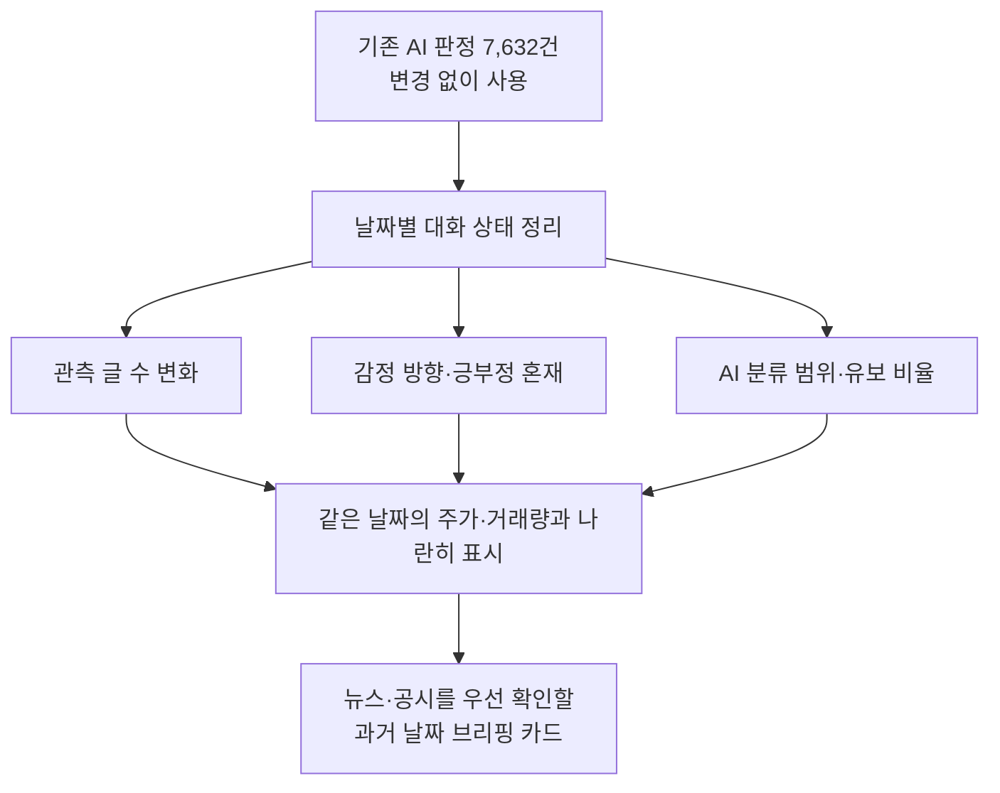
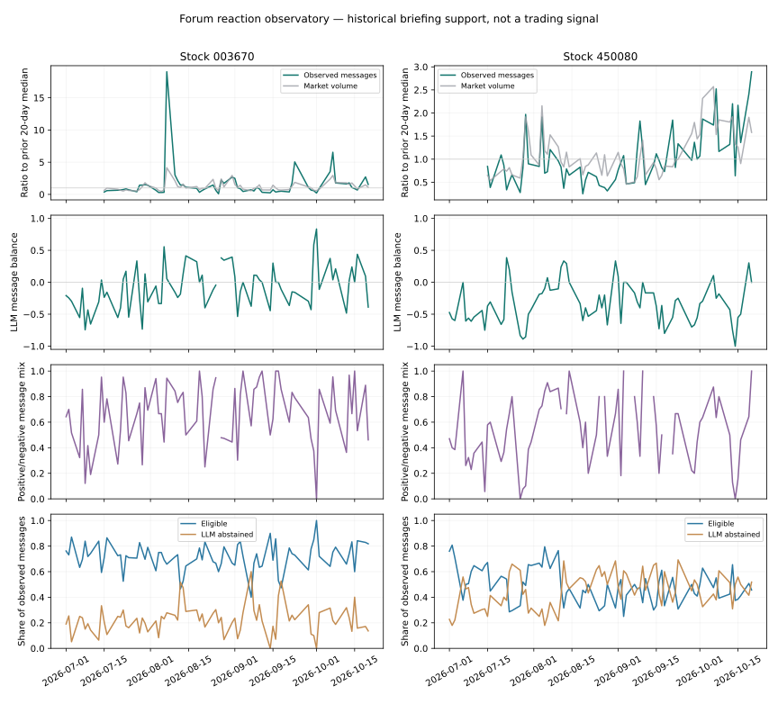

# 새 목표: 종목 커뮤니티 반응을 정리하는 시장 브리핑 보조 도구

**앞으로는 ‘내일 주가 맞히기’보다 ‘지금 살펴볼 만한 대화와 날짜를 찾기’에 초점을 둡니다.**

2026-10-21 사용자 지시에 따라 작업 폴더의 연구 목적을 전환했습니다.
이미 AI가 판정한 **7,632건은 그대로 사용**합니다. 추가 AI 분류나 사람 검수를 하지 않았습니다.
기존 예측 분석에서 개선을 확인하지 못한 결과도 [이전 분석 기록](저비용LLM_전체분석.md)에 보존합니다.
새 목적을 선택했다고 기존 예측 실험이 성공한 것으로 바꾸지는 않습니다.

## 1. 주식시장에서 어떻게 쓸 수 있나요?

개별 종목을 살펴볼 때 가격만 보면 그날 게시판에서 어떤 대화 구성이 나타났는지 알기 어렵습니다.
반대로 글을 전부 읽으려면 시간이 많이 걸립니다.
이 도구는 **뉴스·공시·시장 상황을 추가로 확인할 날짜를 고르는 보조 자료**를 만듭니다.

| 확인할 질문 | 제공할 정보 |
| --- | --- |
| 이 날짜는 관측 글이 평소보다 많았나? | 같은 종목의 직전 기록 대비 글 수 배수 |
| 긍정과 부정 중 어느 쪽이 많이 분류됐나? | 긍정·부정·중립 수와 비중 |
| 평균은 비슷해도 서로 반대되는 표현이 많이 나왔나? | 긍정·부정 글의 혼재 정도 |
| AI가 얼마나 판단할 수 있었나? | 사용한 글 수, 유보·혼합 비율 |
| 시장은 같은 날 어떤 모습이었나? | 당일 수익률과 거래량 배수 |

이 정보로 매수·매도 시점이나 수익을 보장하지 않습니다.
현재 시제품의 가치는 **관측 자료를 빠르게 읽고 비교할 수 있게 하는 것**이며,
실제 투자자의 시간 절약이나 판단 개선 효과는 아직 검증하지 않았습니다.

## 2. 새 연구 질문

> **수집한 두 종목의 자료에서, 평소와 다른 관측 게시량과 감정 구성을 어떻게 드러내고 시장 브리핑에 활용할 수 있을까?**



연구 범위는 포스코퓨처엠·에코프로머티의 2026-07-01~10-20입니다.
날짜별 관측표에는 시세 달력에 배정 가능한 7,602건을 사용합니다. 마지막 종가 뒤 30건의 AI 판정도 보존하지만, 다음 거래일 시세가 없어 카드에는 반영하지 않습니다.
거래일 구간은 이전 거래일 종가 직후부터 당일 15:30까지이며, 휴일·장후 글은 다음 거래일에 배정합니다.
지금은 과거 자료를 보는 시제품이며, 실시간 감시 서비스가 아닙니다.

## 3. 실제 자료에서 발견한 활용 예

**포스코퓨처엠 · 2026-08-07**을 관측 글 수 배수 기준으로 골랐습니다.
주가가 오른 날을 찾아 고른 사례가 아닙니다.

| 항목 | 관측 결과 |
| --- | --- |
| 수집 자료의 글·댓글 수 | **733건**, 직전 기준의 약 **19.04배** |
| AI 긍정 / 부정 / 중립 | **255 / 228 / 0건** |
| 평균 감성 점수 | **+0.056**, 0에 가까움 |
| AI 판단유보 / 혼합 | **204 / 46건** |
| 같은 날 시장 상황 | 수정주가 수익률 약 **+5.63%**, 거래량은 직전 기준의 약 **4.15배** |

평균 점수만 보면 중립에 가까워 보이지만, AI 판정상으로는 **긍정과 부정 표현이 모두 많이 나온 날**입니다.
따라서 브리핑에서는 다음처럼 보여주는 편이 더 유용할 수 있습니다.

> 관측 게시량이 평소보다 많고, 긍정·부정 표현이 비슷하게 분류됐습니다.
> 평균 점수 하나로 요약하지 않고, 이 날짜의 뉴스·공시를 먼저 확인할 후보로 제시합니다.
> 감정 분류 가능 글은 483/733건입니다. 원인과 투자 효용은 아직 확인하지 않았습니다.

**19배는 이 수집 표본 안의 배수**입니다. 전체 투자자의 관심이나 전체 게시판 글 수가 19배 늘었다고 해석하지 않습니다.

## 4. 무엇을 계산했나요?

| 지표 | 계산 방법 | 의미와 한계 |
| --- | --- | --- |
| 관측 활동 배수 | 당일 관측 글 수 ÷ 직전 최대 20거래일의 중앙값 | 같은 종목 안의 비교. 최소 10일의 이전 자료가 있어야 계산 |
| 방향 점수 | (긍정 − 부정) ÷ 유효 글 수 | 기존 LLM 점수 재사용. 중립 포함, 유보·혼합 제외 |
| 부정 비중 | 부정 ÷ 유효 글 수 | 유효 글이 5건 미만이면 비워 둠 |
| 긍부정 혼재도 | 2 × 긍정·부정 중 작은 수 ÷ (긍정 + 부정) | 1에 가까우면 두 방향 글 수가 비슷함. 방향 글이 5건 미만이면 비워 둠 |
| 분류 가능 비율 | 유효 글 ÷ 전체 관측 글 | AI의 처리 범위이며 정확도 점수가 아님 |
| AI 유보 비율 | 판단유보 글 ÷ 전체 관측 글 | 시장의 불확실성이나 투자 위험 확률을 뜻하지 않음 |
| 시장 거래량 배수 | 당일 거래량 ÷ 직전 최대 20거래일의 중앙값 | 그날의 시장 상황 참고용 |

중앙값은 숫자를 크기순으로 놓았을 때 가운데 값입니다.
기준 계산에서는 **당일과 미래 날짜를 제외**합니다.
처음 10거래일은 이전 자료가 부족해 활동 배수를 표시하지 않습니다.
감정을 계산할 때는 기존과 같이 5건 이상이 필요합니다. 이 최소값이 통계적 안정성을 보장하는 것은 아닙니다.

긍부정 혼재도는 **글의 구성**입니다. 작성자 정보를 사용하지 않으므로 서로 다른 투자자들이 의견 충돌을 했다고 단정하지 않습니다.

## 5. 어떤 산출물을 만들었나요?

- **148개 종목·거래일의 관측표:** 글 수·구성비·혼재도·분류 범위·시장 상황
- **브리핑 카드 6개:** 종목별 활동 배수가 큰 날짜 3개씩
- **집계 그림:** 날짜에 따른 변화 비교
- **설정별 선택 날짜 수:** 기준을 바꾸면 얼마나 달라지는지 공개

| 설명용 활동 배수 기준 | 포스코퓨처엠 | 에코프로머티 |
| --- | --- | --- |
| 1.5배 이상 | 17일 | 11일 |
| 2배 이상 | 10일 | 5일 |
| 3배 이상 | 5일 | 0일 |

각 종목에서 이전 자료가 충분한 **64일씩**을 비교했습니다.
이 값들은 설명용 기준이며, 어느 기준이 유효한 투자 경보인지는 검증하지 않았습니다.
주가 결과가 가장 좋게 나오는 기준을 골라 사용하지 않습니다.



왼쪽은 포스코퓨처엠, 오른쪽은 에코프로머티입니다.
위에서부터 활동·시장 거래량 배수, 감정 방향, 긍부정 혼재도, 분류 가능·AI 유보 비율입니다.
맨 위 그래프의 세로축 범위는 종목별로 다르므로 높이를 그대로 종목 간 비교하지 않습니다.

## 6. 새 목표의 성공 기준

**높은 수익률이나 유의한 상관관계가 나오는 것을 성공 조건으로 삼지 않습니다.**

1. 원래 AI 판정을 바꾸지 않고 모든 수치를 재현할 수 있을 것.
2. 글 수·분모·사용 범위·자료 부족을 숨기지 않을 것.
3. 평소 기준에 당일·미래 자료를 섞지 않을 것.
4. 조건을 바꿀 때 확인 후보 날짜가 얼마나 달라지는지 보여줄 것.
5. 예측·실제 투자자 심리·시장 위험으로 오해되지 않게 설명할 것.

여기까지는 시제품과 데이터 품질 기준입니다.
실제로 브리핑 작성 시간을 줄이는지, 중요한 날짜를 놓치지 않는지 등은 별도의 사용자 평가가 필요하며 아직 하지 않았습니다.

## 7. 연구 근거와 적용 범위

금융 SNS 연구는 작성자의 기분과 시장에 대한 전망이 다를 수 있음을 지적합니다.
따라서 단일 긍정·부정 점수를 시장 전망으로 바로 치환하지 않고 구성과 처리 범위를 함께 봅니다.
[금융 SNS 1만 건 주석 연구](https://aclanthology.org/2020.lrec-1.749/)

사회적 뉴스 확산 연구도 수익률 방향뿐 아니라 거래량·시장 반응·논의 지속성을 다룹니다.
이는 브리핑 보조라는 연구 방향을 고려할 근거이지, 우리 지표의 효용을 입증한 것은 아닙니다.
[NBER 연구 초록](https://www.nber.org/papers/w30860)
이 자료는 검색에서 제공된 초록을 확인했으며 본문 페이지·PDF 접근은 403으로 제한됐습니다.

두 종목·한 플랫폼·약 3.7개월 자료이므로 시장 전체에 일반화하지 않습니다.
특히 날짜별 수집 완전성과 수집 조건이 같았는지 확인되기 전에는 활동 배수를 **표본 내 기술통계**로만 사용합니다.
공통 뉴스·가격 변화가 대화와 거래량 모두에 영향을 줄 수 있어 같은 날 함께 움직인다고 인과관계를 주장하지 않습니다.

## 8. 실행 방법과 다음 작업

```bash
# 김정기/data_collection 폴더에서, 기존 입력을 받은 환경에서 실행
.venv/bin/python -m analysis.market_observatory \
  --daily state/llm_full_20261021/daily_corrected/daily.csv \
  --market state/full_analysis_redacted_20261021/data/interim/market.csv \
  --output state/market_observatory_new
```

기존 결과는 `state/market_observatory_v1_20261021/`에 있습니다.
`daily_profile.csv`, `example_cards.csv`, `브리핑예시.md`, `summary.json`, 그림을 생성합니다.
이 실행은 **추가 LLM 호출·추가 수집·추가 사람 라벨링을 하지 않습니다.**
기존 입력은 Git에 없으므로 새 컴퓨터에서는 별도로 받아야 합니다.

다음 우선순위는 날짜별 수집 범위·누락 기록을 점검해 관측량 비교의 조건을 확인하고,
팀 발표에서 브리핑 카드가 이해하기 쉬운지 확인하는 것입니다.
유보한 글을 억지로 재분류하거나 주가 예측이 잘되는 조건을 찾는 작업은 현재 목표가 아닙니다.
