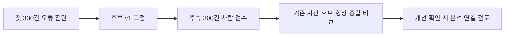

# 첫 사람 검수 결과와 후속 평가 계획

2026-10-21 첫 300건의 단독 사람 검수 완료. 입력·내보내기 SHA 및 revision 300 일치, 보류 0건 확인.
평가자 간 일치도는 측정하지 않았다.

| 기준 | 기존 사전 | 실험 후보 v1 |
| --- | --- | --- |
| 첫 300건 일치율 | 174건, 58.0% | 183건, 61.0% |
| Macro-F1: 세 감정을 균형 있게 평가 | 0.3561 | 0.4395 |
| 사람이 부정으로 본 89건 중 맞힌 수 | 7건 | 11건 |

모든 글을 중립으로 답하면 첫 표본의 62.0%가 맞는다. 후보도 이 일치율에 못 미친다.
기존 사전의 불일치 126건 중 94건에는 사전의 긍정·부정 표현이 전혀 없었다.
부정어 신호는 26건, 양방향 감성 표현은 2건, 질문·정보 전달 신호는 14건에 있었다.
항목은 겹치며 신호의 존재만으로 오분류 원인을 확정하지 않는다.

## 실험 후보

`analysis/sentiment_candidate.py`의 neutral_phrase_v1은 기존 분류가 중립일 때만
양전·마이너스·괜히 샀 등의 명시적 표현을 보완한다.
이모지·욕설·응원만으로 방향을 추측하지 않고 부모 글 감정을 상속하지 않는다.
기존 긍정·부정 판단은 유지한다. 상반된 추가 표현이 섞이면 중립을 유지한다.
기존 300건을 참고한 규칙이므로 위 숫자는 개발 결과이며 독립 성능 검증이 아니다.
기본 분류기와 기존 시계열 분석 결과는 교체하지 않았다.



## 후속 표본과 사전 평가 기준

입력: `data/labels/human_followup_20261021/review.csv`.
기존 표본 ID·같은 본문·이미 읽은 부모 글과 같은 본문을 제외했다.
기존 검수 본문이 새 댓글의 부모 맥락으로 나오는 경우도 제외했다.
후속 표본 안에서도 같은 본문은 한 번만 뽑았다.
같은 두 종목·기간의 내부 후속 표본이므로 미래 기간에 대한 독립 검증은 아니다.
유사 문장·대화 맥락의 완전 독립성은 보장하지 않는다.
본문 중복 제외 때문에 원래 전체 게시글 행의 분포를 그대로 대표하지도 않는다.

- 후보 v1을 고정하며 후속 라벨을 보고 규칙을 수정하지 않는다.
- 기존과 같은 긍정·중립·부정 정의를 사용한다.
- 기존 사전·후보·항상 중립 기준의 일치율, Macro-F1, 감정별 재현율을 함께 보고한다.
- 교체 검토 조건: 후보 Macro-F1이 두 기준보다 높고, 부정 재현율이 기존보다 높으며, 일치율이 기존보다 낮지 않을 것.
- 이는 내부 검토 조건이며 통계적 유의성이나 미래 예측 개선을 뜻하지 않는다.
- 조건 미달이면 기본 분류기를 유지한다. 이 표본도 규칙 수정에 쓰면 최종 평가로 주장하지 않는다.

## 별도 검수 세션 실행

```bash
# 김정기/data_collection 폴더에서
python3 -m review_tool.server \
  --input data/labels/human_followup_20261021/review.csv \
  --output data/labels/human_followup_session \
  --port 8769
```

브라우저 주소는 `http://127.0.0.1:8769`다.
기존 progress.json을 복사하지 않고 첫 검수 결과를 보존한다.
설치·저장·내보내기는 [실행 안내](../review_tool/README.md)를 따른다.

## 개발 재현

```bash
.venv/bin/python -m analysis.human_review \
  --gold data/labels/human_review_session/exports/gold-20261021T104938256996Z.csv \
  --scored state/full_analysis_redacted_20261021/data/interim/posts_scored.csv \
  --output state/human_review_diagnosis_new

.venv/bin/python -m analysis.sentiment_candidate \
  --scored state/full_analysis_redacted_20261021/data/interim/posts_scored.csv \
  --output state/sentiment_candidate_new/posts_scored.csv
```

진단 도구는 ID 중복·허용 라벨·연결 누락을 검사한다.
원문·표현을 담은 오류 목록은 Git 제외 state 아래에만 저장한다.
후속 표본 생성은 `python -m integration.prepare_followup_review --help` 참고.
입력·검수 결과·실험 예측은 Git에 올리지 않는다.
