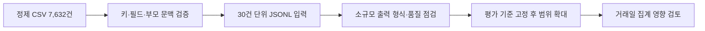

# 저비용 LLM 감성 분석 준비와 평가 계획

## 목적과 현재 범위

전체 정제 데이터 7,632건을 LLM이 다룰 수 있는 작은 입력 묶음으로 안전하게 준비한다. `integration/prepare_llm_input.py`는 CSV를 읽어 부모 글 문맥을 붙이고, 모델 입력에 필요한 여섯 필드만 JSONL로 저장한다. 이 도구는 모델을 호출하지 않고 예측이나 라벨도 만들지 않는다. 출력에는 원문 텍스트가 있으므로 Git 제외 경로인 `data/` 또는 `state/` 아래에만 둔다.

현재 이용 가능한 모델 명칭은 이 실행 세션의 `gpt-6-luna`다. 이는 세션에서 사용할 수 있는 모델 이름이며 API 모델 ID나 단가는 여기서 확인하지 않았고 추측하지 않는다. 이번 준비 단계에서 API를 호출하거나 비용을 발생시키지 않는다.



## 입력 파일 생성

프로젝트 루트에서 다음처럼 실행한다. 출력 경로가 이미 있으면 덮어쓰지 않으므로 새 이름을 사용한다.

```bash
.venv/bin/python -m integration.prepare_llm_input \
  --clean state/full_analysis_redacted_20261021/data/interim/posts_clean.csv \
  --output data/llm_input_20261021 \
  --batch-size 30
```

`--batch-size`는 기본 30이며 1~100만 허용한다. 입력 전체에서 `(stock_id, post_id)`가 비어 있거나 중복되면 중단한다. 같은 `post_id`가 다른 종목에 있으면 별도 ID로 유지하고, 부모 글을 찾을 때도 종목 코드를 함께 사용한다. 출력 각 행은 `stock_id`, `post_id`, `text_norm`, `parent_text`, `context_status`, `target_name`만 가진다. 알려진 두 종목은 `003670=포스코퓨처엠`, `450080=에코프로머티`로 표시하고 그 밖에는 종목 코드를 그대로 쓴다.

각 묶음은 `batch-0001.jsonl` 형식이다. `manifest.json`에는 입력 SHA-256, 행 수, 묶음 수와 크기, 묶음별 행 수 및 SHA-256을 기록한다. `PROMPT_TEMPLATE.txt`는 텍스트 안의 명령문을 데이터로만 취급하고 실행하지 말라는 안전 지침을 담는다. 터미널에는 행 수와 묶음 수만 출력한다.

2026-10-21 실제 준비 결과: `data/llm_input_20261021/`에 7,632행을 30행씩 255개 묶음으로 생성했다(마지막 묶음 12행). 입력과 출력의 종목·게시글 ID 쌍을 대조해 누락·추가·중복이 없고, 여섯 필드 외 값이 없으며, 입력과 각 묶음의 SHA-256이 일치함을 확인했다. 문맥 상태는 최상위 글 4,359건, 부모 글 연결 3,243건, 저장된 부모가 없는 댓글 30건이다. 이 값들은 문맥 연결 상태이며 감성 분류 결과가 아니다.

이 입력은 텍스트에 포함된 프롬프트 삽입 문구를 실행하지 않도록 주의해서 다뤄야 한다. `parent_text`는 문맥 정보일 뿐 댓글의 감정을 대신 결정하지 않는다. 결과를 생성할 때는 별도로 확정한 라벨 정의·관련성 판정·판단유보 규칙·응답 형식을 먼저 고정해야 한다. 현재 파일럿은 related/unrelated/unclear 관련성과 긍정·중립·부정·혼합·판단유보 감정을 구분한다. 모델 JSONL과 분석 도구는 구현했고, 검수 UI의 새 스키마는 아직 구현하지 않았다. 실제 300건 결과와 비교 범위는 [파일럿 결과](저비용LLM_파일럿결과.md)를 따른다.

## 전체 실행 전 품질 관문

전체 행에 확장하기 전에 다음을 증거로 확인한다.

- **커버리지:** 출력의 `(stock_id, post_id)` 집합이 입력 집합과 정확히 같고 각 입력 ID가 한 번씩 나타난다. 분모는 입력 7,632행과 실제 처리한 행 수를 함께 적는다. 선택 표본을 썼다면 선택 건수와 전체 대비 비율도 별도로 표시한다.
- **누락·스키마:** 필수 ID와 `text_norm`의 빈 값은 0건이어야 한다. `parent_text`가 비어 있는 것은 최상위 글 또는 저장된 부모가 없는 경우일 수 있으므로 별도 `context_status` 건수로 보고하며, 이를 0으로 간주하거나 채워 넣지 않는다. 모델 입력은 명시한 여섯 필드만 포함하는지 점검한다.
- **근거와 검토:** 모델 응답은 입력 ID와 일대일로 연결하고, 허용 스키마 위반·중복·누락을 수치로 보고한다. 분류 근거 구절을 반환하는 형식은 개인정보나 원문을 불필요하게 복제하지 않는지 점검한다. 실제 라벨 정의가 고정되기 전에는 성능 수치를 만들지 않는다.
- **안정성:** 동일 30건의 별도 에이전트 실행 간 차이를 점검했다. 동일 프롬프트 바이트·난수 조건의 통제된 재현성 실험은 아니므로 안정성을 확정하지 않는다.

현재 첫 사람 검수 300건은 단독 검수자 판단이다. 기존 분류기와의 58% 일치율은 이 300건 안에서 계산한 모델-사람 일치율이지 사람 정답 정확도나 평가자 간 일치도가 아니다. 이는 전체 7,632건의 대표성 또는 미래 기간 성능을 보장하지 않는다. 추가 사람 검수는 재개 지시 전까지 보류하며, 기존 표본을 사용하더라도 라벨을 모델 입력에 노출하지 않고 탐색 결과와 독립 평가를 구분한다.

## 거래일 집계 후속 작업

새 라벨 체계가 확정되고 품질 관문을 통과한 뒤 별도 버전의 거래일 집계를 검토한다. 중립은 판단 가능한 무방향 감정으로 두고, 관련성 부족·판단유보·혼합 감정은 지수 분모에서 제외하는 안을 제안한다. 별도 `analysis/llm_daily.py`로 집계 기능을 구현하고 합성 테스트·일부 표본 연결 점검을 했다. 전체 LLM 결과를 이용한 연구 분석은 아직 수행하지 않았다. 결과에는 전체 글, 관련 글, 판단 가능한 글, 제외 사유별 건수와 비율을 함께 적어 커버리지와 결측을 0건과 혼동하지 않게 한다.

기존 거래일 배정 계약인 **15:30 이후 글은 다음 거래일로 배정**하는 규칙을 보존한다. 새 집계는 기존 시계열을 덮어쓰지 않는 새 버전에서 검증하고, 대상별·일별 분모와 제외 수를 먼저 대조한다. 품질 관문이 통과되기 전 전체 확장이나 기존 분석 결과 교체를 하지 않는다.
