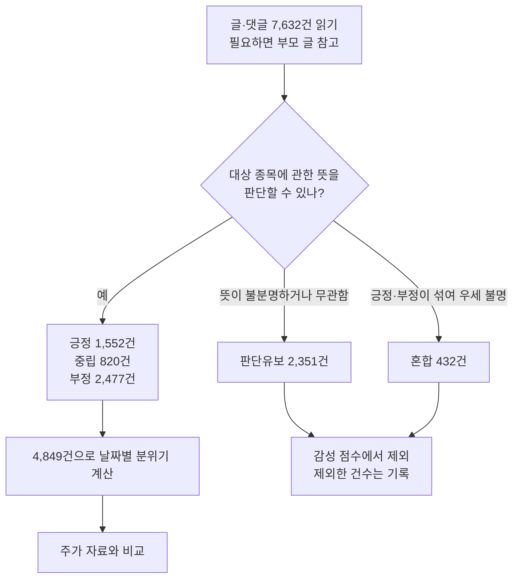
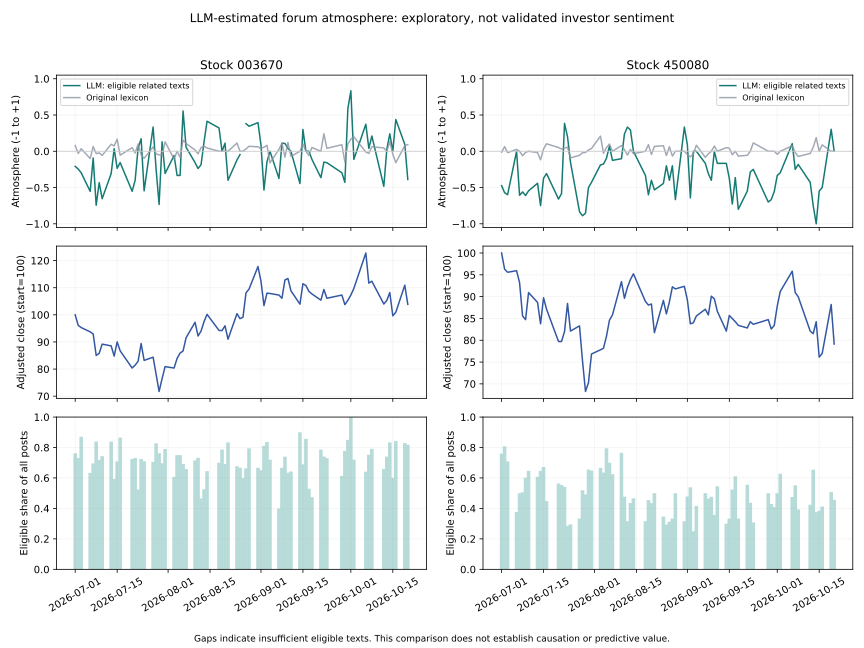

# AI로 게시판 분위기를 분석해 보니 — 쉬운 결과 안내

> 현재 목적 (2026-10-21 사용자 지시): 기존 AI 판정 7,632건을 그대로 활용한 **종목 커뮤니티 반응 관측·시장 브리핑 보조**로 전환했습니다. 이전 예측 결과는 보존하며 추가 사람 검수는 보류합니다. [새 목적과 시제품](목적전환_시장브리핑.md)


**AI가 글을 읽고 게시판 분위기를 정리하는 작업은 끝났습니다. 하지만 그 분위기를 넣었을 때 주가 예측이 더 좋아지지는 않았습니다.**

2026-10-21 기준 결과입니다. 여기서 **LLM은 글을 읽고 판단하는 AI 모델**을 뜻합니다.
이번에는 저비용 모델인 `gpt-6-luna` 에이전트 3개를 사용했습니다.

## 1. 무엇을 알아보려 했나요?

질문은 **“주식 게시판의 분위기가 주가 움직임과 관련 있을까?”**입니다.
AI에게 글이 해당 종목에 대해 긍정적인지, 중립적인지, 부정적인지 읽게 한 뒤
하루 분위기를 숫자로 만들고 주가 자료와 비교했습니다.

| 분석 대상 | 사용한 자료 |
| --- | --- |
| 종목 | 포스코퓨처엠(003670), 에코프로머티(450080) |
| 기간 | 2026-07-01~10-20, 종목별 74거래일 |
| 글·댓글 | 정리된 자료 **7,632건 전체** |

거래일은 주식시장이 열리는 날입니다. 이번 결과는 이 두 종목과 기간에 관한 예비 분석입니다.

## 2. AI는 글을 어떻게 처리했나요?



**모르는 글에도 답을 강요하지 않았습니다.**
종목과 무관하거나 뜻을 알기 어려운 글은 ‘판단유보’, 긍정과 부정이 함께 있어
어느 쪽인지 정하기 어려운 글은 ‘혼합’으로 남겼습니다.

전체 중 **4,849건(63.5%)**을 긍정·중립·부정으로 분류해 분위기 계산에 사용할 수 있었습니다.
나머지 **2,783건(36.5%)**은 판단유보 또는 혼합이었습니다.
이 숫자는 **분류한 비율**이며, AI의 정확도가 63.5%라는 뜻은 아닙니다.

## 3. 하루 분위기는 어떻게 계산하나요?

> **설명용 가상 예시:** 판단 가능한 글이 긍정 6건, 중립 2건, 부정 2건이라면<br/>
> 분위기 점수 = (긍정 − 부정) ÷ 판단 가능한 글 수<br/>
> = (6 − 2) ÷ 10 = **+0.4**

점수가 높으면 긍정 쪽, 낮으면 부정 쪽입니다. 중립은 전체 건수에 포함합니다.
무관·판단유보·혼합은 점수 계산에 넣지 않습니다.
**판단 가능한 글만 모은 분위기**이므로, 게시판 전체 이용자의 생각을 그대로 대표하지는 않습니다.

글은 15:30을 기준으로 거래일에 배정합니다. 장 마감 뒤나 휴일의 글은 다음 거래일로 넘깁니다.
이번 시세 자료의 마지막 종가 뒤에 작성된 30건은 다음 거래일 자료가 없어 일별 계산에서 제외했습니다.

| 종목 | 분위기를 계산할 수 있었던 날 |
| --- | --- |
| 포스코퓨처엠 | 74거래일 중 **73일** |
| 에코프로머티 | 74거래일 중 **74일** |

하루에 판단 가능한 글이 5건 미만이면 점수를 비워 둡니다.
**자료 부족을 뜻하며, 중립인 0점으로 채우지 않습니다.**

## 4. 그래서 주가 예측에 도움이 됐나요?

**이번 분석에서는 도움이 됐다고 확인하지 못했습니다.**

두 가지 예측을 비교했습니다.

- **기본 예측:** 기존 주가 움직임·시장 움직임·글 수를 사용
- **감성을 추가한 예측:** 위 정보에 LLM이 계산한 게시판 분위기를 추가

아래는 감성을 추가했을 때의 **예측 오차 점수 변화**입니다. 점수가 작아야 더 좋은 예측입니다.

| 종목 | 비교한 예측 횟수 | 감성 추가 후 오차 점수 |
| --- | --- | --- |
| 포스코퓨처엠 | 31회 | 약 **1.4% 커짐** |
| 에코프로머티 | 32회 | 약 **7.8% 커짐** |

오차 점수는 크게 틀린 예측에 더 큰 벌점을 주는 **평균제곱오차(MSE)**로 계산했습니다.

이는 **이번 자료와 예측 방식에서 개선을 확인하지 못했다**는 결과입니다.
모든 게시판 분위기가 언제나 쓸모없다는 결론은 아닙니다.
새로운 미래 기간에서 별도로 확인한 결과도 아닙니다.

### 그림은 이렇게 읽으면 됩니다



| 그림 위치 | 의미 |
| --- | --- |
| 왼쪽 / 오른쪽 | 포스코퓨처엠 / 에코프로머티 |
| 위쪽 청록색 선 | LLM이 계산한 분위기 |
| 위쪽 회색 선 | 기존 단어 사전으로 계산한 분위기 |
| 가운데 파란색 선 | 시작 가격을 100으로 맞춘 주가 변화 |
| 아래 막대 | 그날 전체 글 중 분위기 계산에 사용한 글의 비율 |

두 감성 선이 다른 이유에는 **분류 방식과 계산에 포함한 글의 차이**가 함께 있습니다.
선이 다르다는 사실만으로 LLM이 더 정확하다고 판단할 수 없습니다.
또한 분위기와 주가가 비슷하게 움직여 보여도, 예측이 가능하거나 한쪽이 다른 쪽의 원인이라는 뜻은 아닙니다.

## 5. AI의 판단은 얼마나 믿을 수 있나요?

**참고할 수 있는 추정치이며, 확정 정답은 아닙니다.**

### 사람과 비교했을 때

기존에 사람이 읽었던 300건 중, 이번 LLM이 긍정·중립·부정으로 답한 **194건만 같은 조건으로 비교**했습니다.

| 방식 | 사람 판단과 같은 답을 낸 비율 |
| --- | --- |
| LLM | **56.2%** |
| 기존 단어 사전 | **48.5%** |
| 모든 글에 ‘중립’이라고 답하는 단순 기준 | **52.6%** |

사람의 판단에도 불확실성이 있으므로, 이 비율을 객관적인 정확도로 볼 수는 없습니다.
또한 AI가 답한 일부 글만 비교했기 때문에 전체 7,632건의 성능을 뜻하지도 않습니다.

### AI에게 다시 읽혔을 때

먼저 시험했던 300건과 이번 전체 실행에서 **같은 본문·부모 글을 받은 300건**을 비교했습니다.
감정 판단이 같았던 것은 **198건(66%)**이었습니다.

작업 범위와 글을 묶은 순서, 에이전트의 실행 맥락이 달라 완전히 같은 조건의 반복 실험은 아닙니다.
그래도 **현재 실행 방식에서 AI의 답이 항상 같지는 않다**는 점은 확인했습니다.
사람이 같은 글을 반복 판단한 결과는 없으므로, AI가 사람보다 더 일관적이라고 확정할 수도 없습니다.

## 6. 이제 어떻게 진행하면 되나요?

**추가 300건 사람 검수는 계속 보류합니다.** 기존 사람 검수 결과도 그대로 보존했습니다.

지금까지 한 일과 확인하지 못한 일을 나누어 연구 결과를 정리하면 됩니다.

| 완료한 일 | 아직 확인하지 못한 것 |
| --- | --- |
| 전체 글·댓글의 LLM 분류 | 실제 작성자의 의도를 얼마나 정확히 읽었는지 |
| 판단유보를 구분한 하루 분위기 계산 | 실행 조건이 달라도 같은 판단을 유지하는지 |
| 기존 방식·주가 자료와 비교 | 새로운 기간에서도 예측에 도움이 되는지 |

연구 보고에는 **“LLM으로 게시판 분위기를 추정했지만, 이번 분석에서는 주가 예측 개선을 확인하지 못했다”**고 설명할 수 있습니다.
유보한 글의 비율과 판단의 불확실성도 함께 제시해야 합니다.

---

<details>
<summary><strong>개발·통계 담당자를 위한 상세 수치와 검증 기록 펼치기</strong></summary>

### 일별 집계에 들어간 자료

| 종목 | 거래일에 배정된 전체 글 | 그중 판단 가능한 관련 글 |
| --- | --- | --- |
| 003670 | 4,373 | 3,092 |
| 450080 | 3,229 | 1,733 |

전체 7,632건 중 마지막 종가 뒤 30건을 뺀 **7,602건**이 거래일에 배정됐습니다.
전체의 유효 판정 4,849건 중 일별 집계에 들어간 것은 **4,825건**입니다.
관련성 판정은 관련 5,666건, 무관 1,072건, 불명 894건입니다.

### 사람 판정과 같은 194건에서 비교한 추가 지표

Macro-F1은 긍정·중립·부정 세 범주의 분류 성능을 균형 있게 요약하는 점수입니다.
여기서는 사람 판정을 비교 기준으로 썼으며, 객관적인 정확도를 보장하지 않습니다.

| 방식 | Macro-F1 |
| --- | --- |
| LLM | 0.5097 |
| 기존 사전 | 0.3222 |
| 항상 중립 | 0.2297 |

첫 300건은 앞선 진단에도 사용했으므로 최종 독립 평가 표본이 아닙니다.
행별 사람 답안과 기존 예측은 분류 에이전트에 제공하지 않았지만,
AGENTS의 과거 집계 수치는 읽을 수 있어 완전히 정보를 차단한 실험은 아닙니다.

### 일관성 추가 점검

파일럿과 전체 실행의 같은 입력 300건에서 관련성은 234건(78.0%),
관련성과 감정 모두는 176건(58.7%) 일치했습니다.

전체 자료에서 같은 종목·본문·부모 맥락이 반복된 것은 50그룹, 113행이었습니다.
43그룹은 관련성과 감정이 모두 같았고, 반복 글 쌍의 결합 판정 일치율은 71/80(88.8%)였습니다.
이것도 중복 자료의 관찰 결과이며 통제된 반복 실험이나 정확도 점수는 아닙니다.

### 주가 비교의 상세 조건

두 분류 방식·두 종목·세 최소 글 수(1·5·10건)·11개 시차를 조합한 132개 탐색 검정을 수행했습니다.
여러 조건을 시험해 우연히 관계가 나올 가능성을 줄이려고 하나의 BH 보정군으로 계산했고,
보정 후 q<0.05인 항목은 10개였습니다.
다만 Pearson 검정의 p값은 날짜 사이의 의존성을 보정하지 않아 확정적인 예측력의 근거로 삼지 않습니다.

예측에서는 과거 자료를 점차 늘려 학습하는 expanding-window 방식을 사용했습니다.
아래는 **감성 추가 MSE / 기본 예측 MSE**이며, 1보다 작아야 해당 표본에서 개선된 것입니다.

| 분류 방식 | 종목 | 예측 횟수 | MSE 비율 |
| --- | --- | --- | --- |
| LLM | 003670 | 31 | 1.0144 |
| 기존 사전 | 003670 | 32 | 1.0369 |
| LLM | 450080 | 32 | 1.0781 |
| 기존 사전 | 450080 | 32 | 1.0179 |

각 행에서는 기본 예측과 감성 추가 예측이 같은 학습·평가 표본을 사용했습니다.
그러나 LLM과 사전 방식 사이에는 결측 차이로 날짜가 달라질 수 있어 MSE를 직접 순위 비교하지 않습니다.
같은 두 종목·기간을 재분석한 사후 진단이며 미래 기간 홀드아웃 검증이 아닙니다.

### 프로그램에서 확인한 것

- 전체 ID·행 수·입력과 출력의 파일 지문(SHA)·판정 값·인용 구절의 원문 포함 여부를 검사했습니다.
- 인용이 실제로 존재해도 AI의 해석이 옳다는 보장은 없습니다.
- 시간대 표시가 없는 한국 시각을 UTC로 오해해 9시간 미는 집계 오류를 발견하고 수정했습니다.
- 수정 후 148개 종목·거래일 모두에서 기존 패널과 전체 글 수가 일치했습니다.
- 자동 테스트 **96개 통과**, 기존 사람 검수 기록(revision 300) 보존을 확인했습니다.
- 집계 그림의 PNG를 직접 열어 범례·날짜·레이아웃을 확인했습니다.

### 실행 조건과 저장 위치

모델은 세션 명칭 `gpt-6-luna`, reasoning effort는 `medium`입니다.
정확한 API 모델 버전, 무작위 생성 설정(temperature·seed), 실제 비용은 미확인입니다.
글을 묶어서 판정했으므로 실행 맥락과 묶음의 영향도 완전히 통제하지 못했습니다.
부모 맥락 누락·풍자·혼합 감정·관련성 해석의 오류가 남을 수 있습니다.

실제 결과는 `state/llm_full_20261021/` 아래에 있습니다.
`assembled`는 전체 판정, `evaluation`은 비교 결과, `daily_corrected`는 올바른 일별 집계,
`study`는 분석 결과, `figures`는 그림입니다.
처음 잘못 집계한 `daily`는 사용하지 않도록 표시(`SUPERSEDED`)해 보존했습니다.
감정 판정·원문·사람 라벨은 수정하지 않았습니다.

원문·개별 예측·인용 근거는 Git에 올리지 않습니다. 문서에는 개인별 글 내용이 없는 집계 SVG만 제공합니다.
재실행 도구의 사용법은 아래 명령으로 확인할 수 있습니다.

```bash
.venv/bin/python -m integration.merge_llm_batches --help
.venv/bin/python -m analysis.llm_results --help
.venv/bin/python -m analysis.llm_daily --help
.venv/bin/python -m analysis.llm_study --help
.venv/bin/python -m analysis.plot_llm --help
```

</details>
