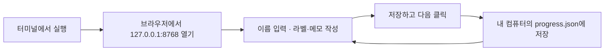
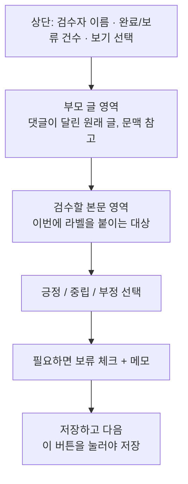
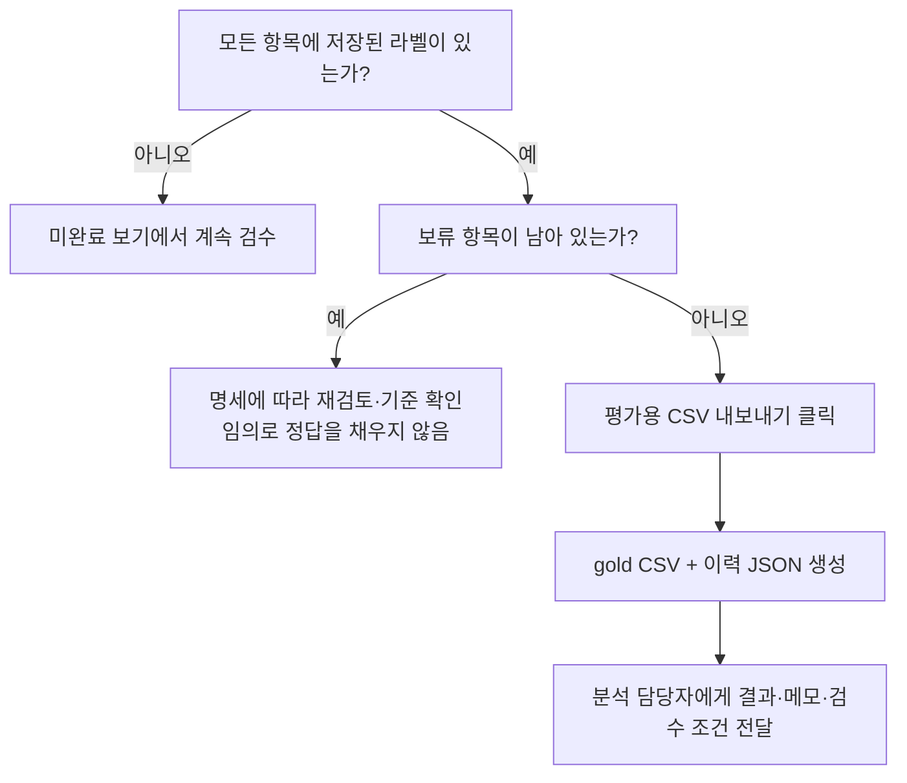

# 검수 담당자를 위한 도구 실행 README

**이 문서는 팀에서 지정할 검수 담당자를 위한 것이다. 김정기에게 사람 검수를 요청하는 안내가 아니다.**
무엇을 판단할지는 [검수 업무 명세](../docs/검수명세.md), 프로젝트 전체 흐름은 [상위 README](../README.md)를 먼저 읽는다.

## 1. 준비물과 설치

| 준비물 | 필요한 이유 |
| --- | --- |
| 저장소의 `kimjunggee-data-collection` 브랜치 | 도구 코드와 문서 |
| Python 3.13 권장, Linux/macOS | 검증된 실행 환경. `fcntl` 사용으로 Windows 기본 Python은 미지원 |
| 별도로 전달받은 `review.csv` | 실제 300건 검수 입력. Git에는 없음 |
| 브라우저 | 로컬 화면 사용 |

Windows 사용자는 WSL의 Linux 환경에 코드와 입력 파일을 준비한다. WSL과 Windows 브라우저의
접속은 환경에 따라 다를 수 있으며 현재 직접 검증하지 않았다. 원격 서버에 실행한 경우
다른 컴퓨터의 127.0.0.1은 그 서버가 아니므로, 가장 간단한 방법은 검수할 컴퓨터에서 직접 실행하는 것이다.
도구를 쓰기 위해 KRX 계정·`.env`·AI API 키·Node.js는 필요하지 않다. 검수 도구 자체는 Python 표준 라이브러리만 사용한다.

새로 코드를 받는 경우:

```bash
git clone --branch kimjunggee-data-collection https://github.com/junggee9711/social_media_2026.git
cd social_media_2026/김정기/data_collection
```

이미 저장소가 있다면 현재 작업을 보존하고 이 브랜치의 최신 코드를 사용한다. 기존 작업 폴더를 덮어 clone하지 않는다.
이하 명령은 모두 `김정기/data_collection` 폴더에서 실행한다.

별도로 받은 미라벨 파일을 다음 위치에 놓는다.

```text
data_collection/
├── review_tool/                        Git으로 받은 코드
└── data/                               Git 제외
    └── labels/
        └── human_review_context_20261021/
            ├── review.csv              별도로 받은 입력
            └── manifest.json           함께 받은 생성 정보
```

입력 필수 컬럼: `stock_id, post_id, parent_id, text_norm, parent_text, context_status`.
파일이 없는 경우 먼저 제공자에게 입력 파일을 받는다. 검수를 위해 토스 재수집 명령을 실행하지 않는다.

## 2. 실행하고 화면 열기

```bash
python3 -m review_tool.server \
  --input data/labels/human_review_context_20261021/review.csv \
  --output data/labels/reviewer_a_session
```

기존 개발 가상환경이 있다면 `python3` 대신 `.venv/bin/python`을 사용할 수 있다.
실행한 컴퓨터의 브라우저에서 **http://127.0.0.1:8768** 을 연다.
터미널은 도구 사용 중 켜 둔다. `로컬 저장`은 인터넷에 제출한다는 뜻이 아니라 해당 컴퓨터에 저장한다는 뜻이다.



독립적으로 두 사람이 검수하면 같은 미라벨 CSV를 쓰되 서로 다른 컴퓨터 또는 출력 폴더를 사용한다.
다른 담당자는 `--output data/labels/reviewer_b_session`처럼 지정한다.
같은 컴퓨터에서 서버 두 개를 실행하려면 두 번째에 `--port 8769`도 추가하고 그 주소로 접속한다.
출력 폴더는 반드시 `data/` 안에 둔다. 파일을 공유하는 동시 협업 서비스는 아니다.

## 3. 화면 이해하기



부모 글 영역에 **“게시글 자체를 검수합니다”**가 나오면 독립 게시글이므로 아래 본문만 판단한다.
“저장된 자료에 부모 글이 없습니다”는 댓글의 맥락을 확보하지 못했다는 뜻이다. 내용을 상상해서 판단하지 않는다.
이모지·짧은 질문 등의 구체적인 처리 예시는 [검수 명세의 애매한 사례](../docs/검수명세.md)에 있다.

| 조작 | 동작 |
| --- | --- |
| 이름 또는 별칭 | 실제 검수자 구분. 다른 사람 이름으로 저장하지 않음 |
| 긍정 / 중립 / 부정, 키보드 1 / 2 / 3 | 현재 라벨 선택. **선택만으로 저장되지 않음** |
| 보류 체크 | 판단을 확정하지 못한 상태로 저장 가능. 라벨 미선택 상태도 가능 |
| 메모 | 근거·맥락 부족·혼합 감정 기록 |
| 저장하고 다음 / Ctrl+Enter | 서버에 저장하고 다음 항목으로 이동 |
| 이전 / 다음으로 건너뛰기 | 저장 없이 이동. 변경을 버릴지 확인할 수 있음 |
| 전체 / 미완료 / 보류 보기 | 이미 입력한 항목 재검토 또는 남은 항목 확인 |
| 평가용 CSV 내보내기 | 모두 확정한 뒤 결과 파일 생성 및 다운로드 |

입력란에 타이핑 중에는 1·2·3이 라벨 단축키로 동작하지 않는다.
“저장 완료” 메시지를 확인한다. 오류가 표시되면 현재 입력을 복사해 두고 원인을 해결한다.
새로고침·종료 전 저장하지 않은 입력은 잃을 수 있다.

## 4. 중단·재개·수정

종료하려면 실행 터미널에서 Ctrl+C를 누른다. 다시 실행할 때 **동일한 input과 output 경로**를 사용하면
이전에 저장한 라벨을 불러온다. 브라우저를 닫아도 서버에 저장된 결과는 남는다.
다른 컴퓨터로 옮긴다면 입력 CSV와 자신의 출력 폴더 전체를 함께 옮긴다. 복사 전 서버를 종료한다.

입력 CSV의 내용·순서·인코딩을 바꾸면 지문이 달라져 재개가 차단될 수 있다.
동일 입력을 받았는지 확인하고 기존 progress.json을 삭제해 해결하지 않는다.
기존 파일을 그대로 유지한 채 새 검수가 필요할 때만 새 output 경로를 사용한다.

## 5. 완료 결과 내보내기와 제출



예시 명령의 출력 폴더 기준:

```text
data/labels/reviewer_a_session/
├── progress.json                       라벨·보류·메모·검수자·저장시각
└── exports/
    ├── gold-<시각>.csv                  stock_id, post_id, label
    └── gold-<시각>.json                 검수자·입력 지문·CSV SHA·revision
```

내보낼 때마다 새 파일이 생성되며 기존 내보내기는 덮어쓰지 않는다. 브라우저 다운로드 외에도
화면에 표시된 로컬 경로에 파일이 저장된다. 라벨을 수정했다면 다시 내보내고 최신 쌍을 전달한다.

분석 담당자에게 **CSV·같은 이름의 JSON·progress.json·검수 조건 설명**을 함께 전달한다.
gold에는 메모가 없기 때문에 `[판단불가]` 항목의 식별에는 progress.json이 필요하다.
미완료라면 gold 대신 진행 파일과 보류 이유를 미완료 산출물로 전달한다.
검수 조건 설명과 완료 체크리스트는 [검수 명세](../docs/검수명세.md)를 따른다.
실제 텍스트·검수 파일은 Git에 커밋하지 않는다.

## 6. 자주 발생하는 문제

| 증상 | 확인·해결 |
| --- | --- |
| `FileNotFoundError` | 입력 파일은 Git에 없다. 전달받은 파일의 위치와 실행 폴더 확인 |
| `No module named review_tool` | `김정기/data_collection` 안에서 명령 실행 |
| `No module named fcntl` | Windows 기본 Python 대신 지원 환경 사용 |
| `Address already in use` | 다른 프로세스를 임의로 종료하지 말고 `--port 8769`로 실행. 브라우저 주소도 변경 |
| 같은 출력 폴더를 사용하는 도구가 실행 중 | 먼저 실행한 서버를 사용하거나 자신의 서버를 Ctrl+C로 종료. 다른 검수자의 결과와 합치지 않음 |
| 페이지 접속 실패 | 터미널 서버 실행 여부, 입력 파일 오류, 접속 컴퓨터·포트 확인 |
| 접근 거절(403) | 출력된 `http://127.0.0.1:포트`로 직접 접속. localhost·다른 호스트명을 쓰지 않음 |
| 다른 탭에서 수정했다는 충돌 | 현재 입력을 복사해 두고 새로고침. 한 탭에서 이어서 작업 |
| 입력 파일 변경 오류 | 원래 입력과 SHA 확인. 진행 파일을 지우거나 임의 편집하지 않음 |
| 내보내기 버튼 비활성 | 라벨 없는 항목, 보류 항목, 아직 저장하지 않은 변경 확인 |

## 7. 분석 담당자가 결과를 연결할 때

자신의 분석 설정 **복사본**에서 `sentiment.gold_path`를 내보낸 CSV의 절대 경로로 설정한다.
도구는 이 설정을 자동 변경하지 않는다. 입력·출력 경로가 기존 결과를 덮어쓰지 않는 별도 실행 폴더인지 확인한다.
아래 명령의 설정 경로는 준비한 파일로 바꾼다.

```bash
# 분석 의존성 설치가 끝난 환경에서 실행. 먼저 계획만 확인.
PYTHONDONTWRITEBYTECODE=1 .venv/bin/python ../../조현호/toss_sentiment/run_pipeline.py \
  -c state/human_evaluation/config/pipeline.yaml plan

# 계획과 입력 경로를 확인한 후 전체 실행
PYTHONDONTWRITEBYTECODE=1 .venv/bin/python ../../조현호/toss_sentiment/run_pipeline.py \
  -c state/human_evaluation/config/pipeline.yaml run
```

위 설정 파일은 자동으로 만들어지지 않는다. 검수 담당자는 이 분석 명령을 실행할 필요가 없다.
분석 담당자는 [명세의 후속 검증](../docs/검수명세.md)에 따라 ID 연결 수와 성능 표를 확인한다.

## 개발 검증 기록

전체 자동 테스트 75개 및 합성 연동 6단계 통과 기록이 있다. 검수 도구의 저장·재개·충돌·내보내기·HTTP 출처 검사는
합성 표본으로 검증했다. 실제 사용자 표본에 테스트 라벨을 저장하지 않았다. 연결 가능한 브라우저가 없어
개발 당시 시각적 브라우저 검증은 미실시했다.

```bash
.venv/bin/python -m pytest -q tests/test_review_tool.py
node --check review_tool/app.js
```

위 개발 검증 명령의 pytest·Node.js는 검수 담당자의 일반 실행에는 필요하지 않다.
